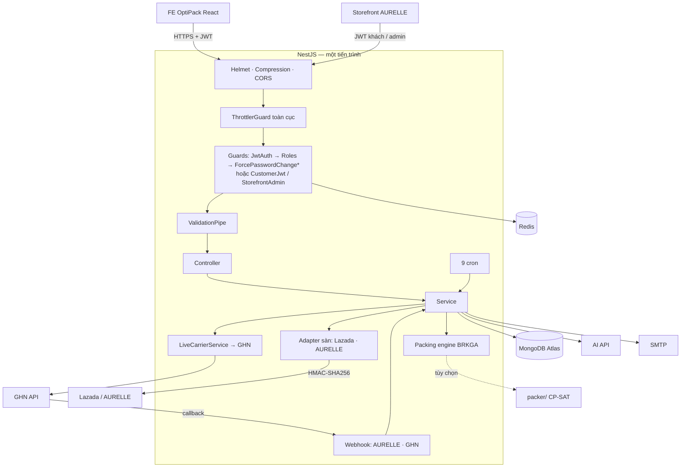
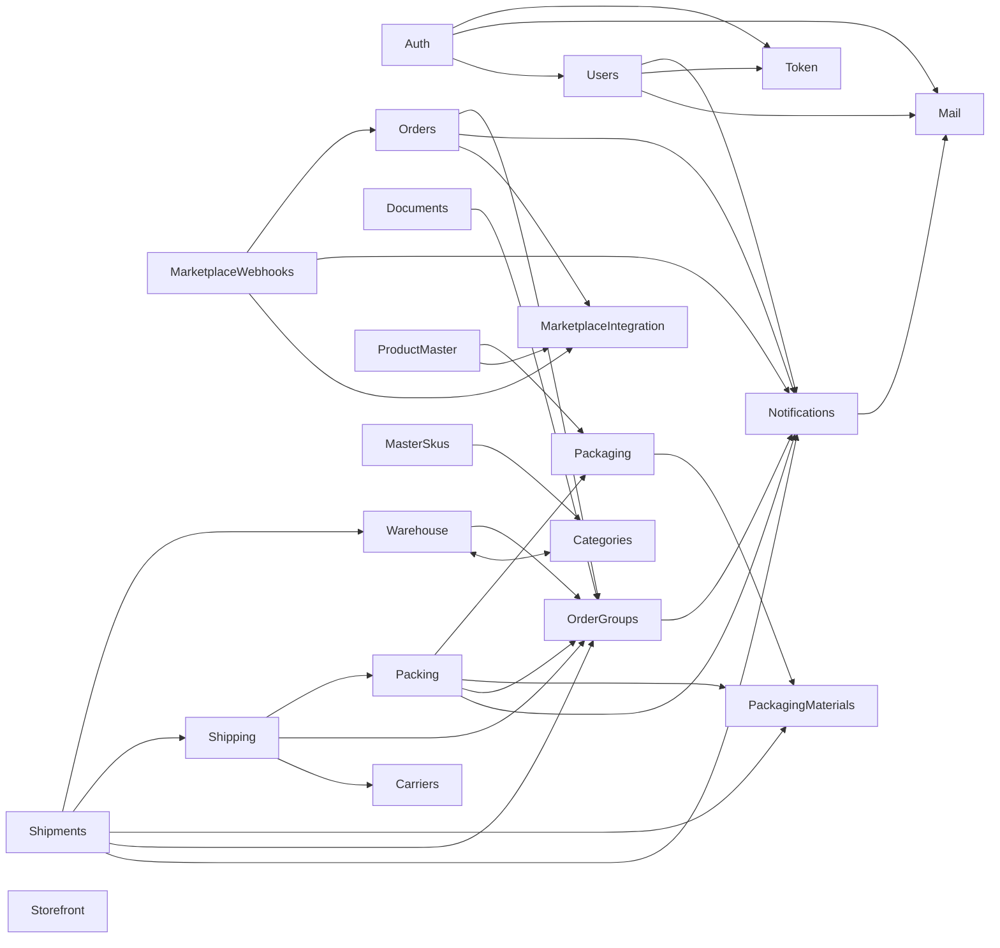

# 01 — Công nghệ và kiến trúc Backend

> Cập nhật 14/10/2026 theo code hiện tại (sau AOFP-79/80: C4–C6 GHN).

## 1. Tổng quan

Backend OptiPackAI là ứng dụng **NestJS** viết bằng **TypeScript**, lưu dữ liệu trên **MongoDB Atlas**, dùng **Redis** làm bộ nhớ đệm. Kiến trúc **modular monolith**: một tiến trình, chia thành 20 module nghiệp vụ. Bên cạnh còn 2 dịch vụ phụ:

- **`packer/`** — microservice Python (FastAPI + OR-Tools CP-SAT) chứng minh phương án xếp hộp tối ưu. Không bắt buộc: tắt thì BE vẫn chạy thuật toán BRKGA trong Node, chỉ thiếu nhãn `optimal_in_model`.
- **`storefront/`** — FE sàn demo AURELLE; BE của nó nằm ngay trong module `storefront` của backend.

Tích hợp bên ngoài: **Lazada Open Platform** (kéo đơn, sản phẩm), **AURELLE** (sàn demo, cùng khuôn API Lazada), **GHN** (báo giá, tạo vận đơn, webhook trạng thái), **AI** (gợi ý hướng dẫn đóng gói), SMTP, Google OAuth.

| Chỉ số | Giá trị |
|---|---|
| File TypeScript (`be/src`, `be/scripts`, `be/test`) | 435 |
| Tổng số dòng mã TS | ~62.500 |
| Module nghiệp vụ | 20 (+ `common`, `config`) |
| Route REST | 239 (30 controller) |
| Collection MongoDB | 50 (49 đăng ký schema) |
| Tác vụ định kỳ (cron) | 9 |
| File test | 85 unit (`*.spec.ts`) + 2 e2e |

## 2. Công nghệ sử dụng và vai trò

### 2.1. Nền tảng

| Công nghệ | Phiên bản | Dùng để làm gì | Ý nghĩa |
|---|---|---|---|
| **Node.js** | ≥ 20 | Môi trường chạy | I/O không chặn, hợp hệ thống gọi nhiều API ngoài |
| **TypeScript** | 5.7+ (`strict`) | Ngôn ngữ | Bắt lỗi kiểu lúc biên dịch |
| **NestJS** | 11 | Framework | Module–Controller–Service, DI, Guard, Pipe, Filter |
| **Express** | 5 | HTTP server bên dưới | |

### 2.2. Dữ liệu

| Công nghệ | Phiên bản | Dùng để làm gì | Ý nghĩa |
|---|---|---|---|
| **MongoDB Atlas** | — | CSDL chính | Replica set → có **transaction nhiều document** (bắt buộc cho trừ tồn, đóng gói, đặt vận đơn) |
| **Mongoose** + `@nestjs/mongoose` | 9.9 / 11 | ODM | ⚠️ Trường id **phải** khai `type: SchemaTypes.ObjectId`; **cấm kiểu Mixed** — test `objectid-fields.spec.ts` quét mọi schema (80 trường) |
| **Redis** + **ioredis** | 6 | Cache | Trạng thái xác thực người dùng 60 giây |

### 2.3. Bảo mật và xác thực

| Công nghệ | Dùng để làm gì |
|---|---|
| **Passport** + **passport-jwt** + `@nestjs/jwt` | JWT HS256 cho nhân viên; JWT riêng cho khách và admin storefront |
| **bcrypt** | Mật khẩu (cost 12), mã dự phòng MFA (cost 10) |
| **crypto (Node)** | SHA-256 cho token; AES-256-GCM cho token sàn; HMAC-SHA256 ký request Lazada/AURELLE |
| **otplib** | TOTP 6 số cho MFA |
| **Helmet** | Header bảo mật HTTP |
| **@nestjs/throttler** | Toàn cục 600 request/phút/IP; login 5/phút; forgot-password 3/phút |
| **class-validator** + **class-transformer** | Kiểm tra DTO, `forbidNonWhitelisted` |

### 2.4. Tích hợp và tiện ích

| Công nghệ | Dùng để làm gì |
|---|---|
| **axios** | Gọi Lazada, AURELLE, GHN, AI, packer, Google |
| **@nestjs/schedule** | 9 cron (Mục 6) |
| **Nodemailer** | Email mật khẩu tạm, quên mật khẩu, thông báo khẩn |
| **pdfkit**, **bwip-js**, **qrcode**, `dejavu-fonts-ttf` | Sinh PDF nhãn kiện (mã vạch, QR, mã GHN, sort code), phiếu lấy hàng, manifest — có font tiếng Việt |
| **@nestjs/swagger** | Tài liệu API `/api/docs` |
| **compression** | Nén gzip |
| **@nestjs/config** | Đọc `.env` theo namespace (`src/config/*.config.ts`, 10 file) |

### 2.5. Chất lượng mã và công cụ

| Công cụ | Vai trò |
|---|---|
| **Jest 30** + **ts-jest** | 85 file unit test + e2e (`be/test`) |
| **ESLint** (type-checked) + **Prettier** | Quy tắc nghiêm ngặt (no-unnecessary-condition, prefer-nullish…) |
| **Husky** + **Commitlint** | Ép định dạng `type(AOFP-<số>): subject` (header ≤ 100 ký tự) |
| **Docker** / `docker-compose.yml` / `k8s/` | Đóng gói BE + packer |
| **ngrok** | HTTPS cho callback OAuth Lazada và webhook GHN khi chạy local |

## 3. Kiến trúc tổng thể

\* `ForcePasswordChangeGuard` chỉ gắn ở `UsersController` — xem 03 và 07.

## 4. Vòng đời một request

1. **Middleware** (`main.ts`): Helmet → compression → CORS (danh sách `CORS_ORIGIN`, mặc định localhost).
2. **ThrottlerGuard** toàn cục (`APP_GUARD`): vượt giới hạn → 429.
3. **Guard của controller**: `JwtAuthGuard` → `JwtStrategy.validate()` (đọc trạng thái user từ Redis/DB, chặn tài khoản khóa, sai vai trò, quá hạn đổi mật khẩu) → `RolesGuard`. Storefront dùng `CustomerJwtGuard` / `StorefrontAdmin*Guard`; webhook dùng khóa bí mật hoặc chữ ký HMAC.
4. **ValidationPipe**: chuyển kiểu, kiểm DTO, từ chối trường lạ.
5. **Controller → Service**: đọc/ghi MongoDB (transaction khi cần), gọi adapter/GHN.
6. Lỗi ném ra (`AppException(errorCode, message, status, details)`) được **GlobalExceptionFilter** chuẩn hóa `{ success:false, error_code, message, details, timestamp, path }`.

## 5. Quan hệ phụ thuộc giữa các module

- `Warehouse ↔ Categories` là vòng duy nhất, xử lý bằng `forwardRef`.
- `Carriers` (module của Thi) quản lý danh mục hãng (`shipping_carriers`, `kind: 'manual' | 'live'`); `Shipping` báo giá; `Shipments` đặt vận đơn và nhận trạng thái.
- `Storefront` độc lập — giao tiếp với OptiPack qua webhook AURELLE giống một sàn thật.
- Ngoài phụ thuộc qua service, nhiều module đăng ký trực tiếp schema của module khác để đọc/ghi thẳng collection (VD `shipments` đăng ký `Order`, `OrderGroup`, `InventoryMovement`). Nhanh nhưng làm nghiệp vụ một collection rải nhiều nơi — đánh giá ở 07.

## 6. Tác vụ định kỳ (9 cron)

| Tác vụ | Lịch | File | Việc làm |
|---|---|---|---|
| `lazada-order-auto-sync` | 5 phút | `orders/lazada-order-sync.scheduler.ts` | Kéo đơn mới/đổi của mọi shop (Lazada + AURELLE), gộp nhóm. Có khóa chống chạy chồng |
| `order-group-backfill` | 5 phút | `order-groups/order-group-backfill.scheduler.ts` | Lưới an toàn tạo nhóm cho đơn lỡ |
| `express-order-sla-check` | 10 phút | `order-groups/express-order-sla.scheduler.ts` | Gắn cờ đơn hỏa tốc quá hạn, thông báo |
| `packing-plan-auto-compute` | **10 giây** | `packing/packing-job.service.ts` | Lấy job tính phương án đóng gói đang chờ và chạy engine |
| `packing-rejection-overdue` | 15 phút | `packing/packing-job.service.ts` | Nhắc phương án bị từ chối chưa xử lý |
| Shipment SLA | 15 phút | `shipments/shipment-sla.scheduler.ts` | Gắn cờ vận đơn quá hạn, thông báo critical |
| `product-master-hourly-catalog-sync` | Mỗi giờ | `product-master/product-master-sync.scheduler.ts` | Đồng bộ sản phẩm thay đổi |
| `product-master-daily-sync` | 3:00 (giờ VN) | như trên | Đồng bộ toàn bộ |
| (Làm mới token sàn) | Khi cần | `marketplace-integration.service.ts` | Refresh token sắp hết hạn trước mỗi lần gọi API |

`ScheduleModule.forRoot()` chỉ đăng ký **một lần** ở `app.module.ts`. Lưu ý: không có cron đồng bộ trạng thái GHN — trạng thái về qua webhook, nút giả lập (demo) hoặc nút "Đồng bộ" thủ công.

## 7. Cấu hình (biến môi trường — xem `be/.env.example`)

| Nhóm | Biến | Ghi chú |
|---|---|---|
| Ứng dụng | `PORT`, `CORS_ORIGIN`, `FRONTEND_URL`, `CLIENT_REDIRECT_CALLBACK`, `THROTTLE_LIMIT_PER_MINUTE` | `CORS_ORIGIN` trống → mặc định localhost |
| CSDL / Redis | `MONGODB_URI`, `REDIS_HOST`, `REDIS_PORT`, `REDIS_PASSWORD` | Mongo phải là replica set |
| JWT | `JWT_ACCESS_SECRET`, `JWT_REFRESH_SECRET`, `JWT_EXPIRES_IN`, `JWT_REFRESH_EXPIRES_IN` | |
| Google | `GOOGLE_CLIENT_ID`, `GOOGLE_CLIENT_SECRET`, `GOOGLE_REDIRECT_URI` | |
| Email | `MAIL_*` | |
| Mã hóa | `TOKEN_ENCRYPTION_KEY` | Đổi khóa → token sàn đã lưu không giải mã được, phải kết nối lại shop |
| Lazada | `LAZADA_APP_KEY`, `LAZADA_APP_SECRET`, `LAZADA_REDIRECT_URI`, `LAZADA_SANDBOX`, `LAZADA_API_BASE_URL` | Đã bỏ `LAZADA_WRITE_APIS_ENABLED`, `LAZADA_SHIPPING_ALLOCATE_TYPE` |
| AURELLE | `AURELLE_APP_KEY`, `AURELLE_APP_SECRET`, `AURELLE_REDIRECT_URI`, `AURELLE_SANDBOX`, `AURELLE_AUTH_PAGE_BASE_URL`, `AURELLE_AUTH_API_BASE_URL`, `AURELLE_API_BASE_URL`, `AURELLE_WEBHOOK_URL`, `AURELLE_SELLER_ID` | **Bắt buộc** — thiếu thì BE không khởi động |
| Storefront | `STOREFRONT_NAME`, `STOREFRONT_ADMIN_EMAIL`, `STOREFRONT_ADMIN_PASSWORD_HASH`, `STOREFRONT_ADMIN_JWT_SECRET` | |
| AI | `AI_API_KEY`, `AI_BASE_URL`, `AI_MODEL`, `AI_TIMEOUT_MS` | Thiếu key → tắt gợi ý AI, nghiệp vụ vẫn chạy |
| Packer | `PACKER_URL`, `PACKER_ENABLED`, `PACKER_TIMEOUT_MS`, `PACKER_MAX_UNITS`, `PACKER_DET_TIME_PER_COMBO`, `PACKER_WALL_TIME_S` | Tùy chọn |
| Vận chuyển | `CARRIER_MODE`, `CARRIER_MANUAL_STATUS_ENABLED`, `CARRIER_DEFAULT_PROVINCE`, `CARRIER_DEMO_RECIPIENT_PHONE` | `CARRIER_MANUAL_STATUS_ENABLED=true` bật nút giả lập trạng thái (demo) |
| GHN | `GHN_BASE_URL`, `GHN_TOKEN`, `GHN_SHOP_ID`, `GHN_DEFAULT_SERVICE_TYPE_ID`, `GHN_DEFAULT_REQUIRED_NOTE`, `GHN_DEFAULT_PAYMENT_TYPE_ID`, `GHN_WEBHOOK_SECRET`, `GHN_TIMEOUT_MS` | Dùng môi trường staging (dev-online-gateway) |
| Seed | `SEED_ADMIN_EMAIL`, `SEED_ADMIN_PASSWORD` | Chỉ cho `npm run seed:admin` |
| TikTok, Tiki | `TIKTOK_*`, `TIKI_*` | Còn trong `.env.example` nhưng chưa có adapter — thừa |

`be/.env` đã gitignore — **không bao giờ commit**.
