# 05 — Thiết kế cơ sở dữ liệu

> Cập nhật 14/10/2026. Mục 2 và 4 **sinh tự động** bằng cách nạp mọi `*.schema.ts` (Mongoose) trên mã hiện tại — 50 collection. CSDL: **MongoDB Atlas** (replica set — bắt buộc cho transaction). ODM: **Mongoose 9** qua `@nestjs/mongoose`. Bản cũ (07–10/10, 29 collection) xem lịch sử git.

## 1. Cách CSDL được tạo

- **Không có migration tạo bảng.** MongoDB tạo collection **tự động** ở lần ghi đầu tiên. Tên collection khai báo trong `@Schema({ collection: ... })`.
- **Index** được Mongoose tạo tự động khi ứng dụng khởi động (`autoIndex` mặc định bật) từ `@Prop({ index/unique })` và `XxxSchema.index(...)`.
- **Timestamps**: hầu hết schema bật `timestamps` và đổi tên thành `created_at`/`updated_at` (snake_case).
- **Khóa phiên bản**: trường `__v` của Mongoose được dùng làm `version` cho khóa lạc quan (các thao tác ghi gửi `expected_version`).
- **Script dữ liệu** (`be/scripts/`): `seed-admin` tạo Admin đầu tiên; các `migrate-*`/`backfill-*` sửa dữ liệu cũ khi đổi thiết kế, chạy 1 lần mỗi môi trường, chạy lại an toàn.
- **Transaction** (`session.withTransaction`) dùng cho các thao tác nhiều collection: lấy hàng, đóng gói + trừ vật liệu, duyệt gợi ý, nhập/kiểm/chuyển tồn, kiểm hàng hoàn.

### 1b. Kiểu dữ liệu của các trường id — 🔄 ĐÃ SỬA 07/10/2026

- 80 trường id tham chiếu (ngoài `_id`, tính cả field trong mảng sub-document) `@Prop({ type: SchemaTypes.ObjectId })`. Danh sách đầy đủ: `src/common/schemas/objectid-fields.ts` (`OBJECT_ID_FIELDS`).
- **Trước 07/10/2026** các trường này khai `type: Types.ObjectId`. Với `@nestjs/mongoose`, cách khai đó tạo ra kiểu **Mixed**: Mongoose không đổi chuỗi sang ObjectId khi truy vấn và lưu nguyên giá trị khi ghi. Hậu quả đã gặp: Picking List "CHƯA GÁN VỊ TRÍ", quét hàng 409, nhập thêm hàng 404 (truy vấn bằng chuỗi id kho); `pick_events.order_group_id`, `notifications.recipient_user_id`/`related_entity_id`, `login_audit_logs.user_id` bị lưu dạng chuỗi.
- **Dữ liệu cũ:** chạy `scripts/migrate-objectid-fields.ts` (chạy thử mặc định, `--apply` để ghi) 1 lần trên mỗi database để đổi các giá trị chuỗi còn sót sang ObjectId. Không chạy thì các bản ghi đó không khớp truy vấn (ví dụ thông báo cũ không hiện cho người nhận).
- **Bảo vệ:** test `src/common/schemas/objectid-fields.spec.ts` quét mọi schema, báo lỗi nếu có trường Mixed hoặc danh sách lệch thực tế. Quy tắc ghi trong `CLAUDE.md` (Database Design Standards, mục 24).

## 2. Tổng quan collection

50 collection khai báo trong `*.schema.ts`; 49 đang được module đăng ký (`MongooseModule.forFeature`).

| Nhóm | Collection | Schema — file | Field | Index | Dùng trong module |
|---|---|---|---|---|---|
| Tài khoản & bảo mật | `users` | `UserSchema` — `modules/users/schemas/user.schema.ts` | 24 | 3 | ✔ |
| Tài khoản & bảo mật | `refresh_tokens` | `RefreshTokenSchema` — `modules/auth/schemas/refresh-token.schema.ts` | 10 | 3 | ✔ |
| Tài khoản & bảo mật | `trusted_devices` | `TrustedDeviceSchema` — `modules/auth/schemas/trusted-device.schema.ts` | 5 | 3 | ✔ |
| Tài khoản & bảo mật | `login_audit_logs` | `LoginAuditLogSchema` — `modules/auth/schemas/login-audit-log.schema.ts` | 7 | 2 | ✔ |
| Tài khoản & bảo mật | `notifications` | `NotificationSchema` — `modules/notifications/schemas/notification.schema.ts` | 12 | 4 | ✔ |
| Kết nối sàn & đơn | `marketplace_shops` | `MarketplaceShopSchema` — `modules/marketplace-integration/schemas/marketplace-shop.schema.ts` | 15 | 2 | ✔ |
| Kết nối sàn & đơn | `marketplace_oauth_states` | `MarketplaceOauthStateSchema` — `modules/marketplace-integration/schemas/marketplace-oauth-state.schema.ts` | 4 | 2 | ✔ |
| Kết nối sàn & đơn | `processed_webhook_events` | `ProcessedWebhookEventSchema` — `common/schemas/processed-webhook-event.schema.ts` | 3 | 2 | ✔ |
| Kết nối sàn & đơn | `orders` | `OrderSchema` — `modules/orders/schemas/order.schema.ts` | 44 | 4 | ✔ |
| Kết nối sàn & đơn | `order_groups` | `OrderGroupSchema` — `modules/order-groups/schemas/order-group.schema.ts` | 31 | 6 | ✔ |
| Kết nối sàn & đơn | `pick_events` | `PickEventSchema` — `modules/order-groups/schemas/pick-event.schema.ts` | 12 | 3 | ✔ |
| Kết nối sàn & đơn | `stock_reservations` | `StockReservationSchema` — `modules/order-groups/schemas/stock-reservation.schema.ts` | 12 | 3 | ✔ |
| Kết nối sàn & đơn | `stock_reservation_totals` | `StockReservationTotalSchema` — `modules/order-groups/schemas/stock-reservation.schema.ts` | 2 | 0 | ✔ |
| Kho & sản phẩm | `warehouses` | `WarehouseSchema` — `modules/warehouse/schemas/warehouse.schema.ts` | 6 | 1 | ✔ |
| Kho & sản phẩm | `warehouse_zones` | `WarehouseZoneSchema` — `modules/warehouse/schemas/warehouse-zone.schema.ts` | 7 | 2 | ✔ |
| Kho & sản phẩm | `bin_locations` | `BinLocationSchema` — `modules/warehouse/schemas/bin-location.schema.ts` | 18 | 6 | ✔ |
| Kho & sản phẩm | `sku_bin_assignments` | `SkuBinAssignmentSchema` — `modules/warehouse/schemas/sku-bin-assignment.schema.ts` | 9 | 5 | ✔ |
| Kho & sản phẩm | `inventory_movements` | `InventoryMovementSchema` — `modules/warehouse/schemas/inventory-movement.schema.ts` | 17 | 4 | ✔ |
| Kho & sản phẩm | `categories` | `CategorySchema` — `modules/categories/schemas/category.schema.ts` | 8 | 2 | ✔ |
| Kho & sản phẩm | `colors` | `ColorSchema` — `modules/master-skus/schemas/color.schema.ts` | 6 | 1 | ✔ |
| Kho & sản phẩm | `master_skus` | `MasterSkuSchema` — `modules/master-skus/schemas/master-sku.schema.ts` | 17 | 2 | ✔ |
| Kho & sản phẩm | `marketplace_sku_mappings` | `MarketplaceSkuMappingSchema` — `modules/master-skus/schemas/marketplace-sku-mapping.schema.ts` | 7 | 2 | ✔ |
| Kho & sản phẩm | `product_master` | `ProductMasterSchema` — `modules/product-master/schemas/product-master.schema.ts` | 26 | 2 | ✔ |
| Đóng gói & vật liệu | `packing_plans` | `PackingPlanSchema` — `modules/packing/schemas/packing-plan.schema.ts` | 190 | 7 | ✔ |
| Đóng gói & vật liệu | `packing_settings` | `PackingSettingsSchema` — `modules/packing/schemas/packing-settings.schema.ts` | 10 | 1 | ✔ |
| Đóng gói & vật liệu | `packaging_materials` | `PackagingMaterialSchema` — `modules/packaging-materials/schemas/packaging-material.schema.ts` | 32 | 3 | ✔ |
| Đóng gói & vật liệu | `packaging_movements` | `PackagingMovementSchema` — `modules/packaging-materials/schemas/packaging-movement.schema.ts` | 14 | 3 | ✔ |
| Đóng gói & vật liệu | `packaging_bags` | `PackagingBagSchema` — `modules/packaging/schemas/packaging-bag.schema.ts` | 11 | 2 | ✔ |
| Đóng gói & vật liệu | `packaging_material_rules` | `PackagingMaterialRulesSchema` — `modules/packaging/schemas/packaging-material-rules.schema.ts` | 13 | 2 | ✔ |
| Đóng gói & vật liệu | `packaging_recommendations` | `PackagingRecommendationSchema` — `modules/packaging/schemas/packaging-recommendation.schema.ts` | 142 | 3 | ❌ không module nào đăng ký |
| Vận chuyển & trả hàng | `shipping_carriers` | `ShippingCarrierSchema` — `modules/shipping/schemas/shipping-carrier.schema.ts` | 18 | 1 | ✔ |
| Vận chuyển & trả hàng | `shipping_settings` | `ShippingSettingsSchema` — `modules/shipping/schemas/shipping-settings.schema.ts` | 6 | 1 | ✔ |
| Vận chuyển & trả hàng | `shipments` | `ShipmentSchema` — `modules/shipments/schemas/shipment.schema.ts` | 65 | 8 | ✔ |
| Vận chuyển & trả hàng | `shipment_events` | `ShipmentEventSchema` — `modules/shipments/schemas/shipment-event.schema.ts` | 13 | 2 | ✔ |
| Vận chuyển & trả hàng | `carrier_webhook_events` | `CarrierWebhookEventSchema` — `modules/shipments/schemas/carrier-webhook-event.schema.ts` | 11 | 2 | ✔ |
| Vận chuyển & trả hàng | `return_requests` | `ReturnRequestSchema` — `modules/shipments/schemas/return-request.schema.ts` | 47 | 3 | ✔ |
| Website AURELLE (storefront) | `storefront_categories` | `StorefrontCategorySchema` — `modules/storefront/schemas/storefront.schema.ts` | 9 | 1 | ✔ |
| Website AURELLE (storefront) | `storefront_products` | `StorefrontProductSchema` — `modules/storefront/schemas/storefront.schema.ts` | 22 | 2 | ✔ |
| Website AURELLE (storefront) | `storefront_product_variants` | `StorefrontProductVariantSchema` — `modules/storefront/schemas/storefront.schema.ts` | 18 | 2 | ✔ |
| Website AURELLE (storefront) | `storefront_images` | `StorefrontImageSchema` — `modules/storefront/schemas/storefront.schema.ts` | 3 | 0 | ✔ |
| Website AURELLE (storefront) | `storefront_inventory_stocks` | `StorefrontInventoryStockSchema` — `modules/storefront/schemas/storefront.schema.ts` | 7 | 1 | ✔ |
| Website AURELLE (storefront) | `customers` | `CustomerSchema` — `modules/storefront/schemas/storefront.schema.ts` | 11 | 1 | ✔ |
| Website AURELLE (storefront) | `customer_addresses` | `CustomerAddressSchema` — `modules/storefront/schemas/storefront.schema.ts` | 11 | 1 | ✔ |
| Website AURELLE (storefront) | `storefront_carts` | `StorefrontCartSchema` — `modules/storefront/schemas/storefront.schema.ts` | 5 | 1 | ✔ |
| Website AURELLE (storefront) | `storefront_cart_items` | `StorefrontCartItemSchema` — `modules/storefront/schemas/storefront.schema.ts` | 7 | 2 | ✔ |
| Website AURELLE (storefront) | `storefront_orders` | `StorefrontOrderSchema` — `modules/storefront/schemas/storefront.schema.ts` | 28 | 7 | ✔ |
| Website AURELLE (storefront) | `storefront_order_items` | `StorefrontOrderItemSchema` — `modules/storefront/schemas/storefront.schema.ts` | 12 | 1 | ✔ |
| Website AURELLE (storefront) | `storefront_payments` | `StorefrontPaymentSchema` — `modules/storefront/schemas/storefront.schema.ts` | 10 | 1 | ✔ |
| Website AURELLE (storefront) | `storefront_shipments` | `StorefrontShipmentSchema` — `modules/storefront/schemas/storefront.schema.ts` | 15 | 1 | ✔ |
| Website AURELLE (storefront) | `storefront_counters` | `StorefrontCounterSchema` — `modules/storefront/schemas/storefront.schema.ts` | 1 | 0 | ✔ |

## 3. Sơ đồ quan hệ (ERD)

```mermaid
erDiagram
  USERS ||--o{ REFRESH_TOKENS : "phiên"
  USERS ||--o{ TRUSTED_DEVICES : "thiết bị tin cậy"
  USERS ||--o{ LOGIN_AUDIT_LOGS : "nhật ký đăng nhập"
  USERS ||--o{ NOTIFICATIONS : "nhận"
  USERS ||--o{ MARKETPLACE_SHOPS : "kết nối"
  USERS ||--o{ ORDER_GROUPS : "được giao (assigned_staff_id)"
  MARKETPLACE_SHOPS ||--o{ ORDERS : "kéo về"
  ORDERS }o--|| ORDER_GROUPS : "consolidated_group_id"
  ORDER_GROUPS }o--o{ ORDER_GROUPS : "recipient_key / manual_link_id"
  ORDER_GROUPS ||--o{ PICK_EVENTS : "lần quét lấy hàng"
  ORDER_GROUPS ||--o{ STOCK_RESERVATIONS : "giữ chỗ tồn"
  STOCK_RESERVATIONS }o--|| STOCK_RESERVATION_TOTALS : "stock_key"
  ORDER_GROUPS ||--o| PACKING_PLANS : "1 kế hoạch đang hoạt động"
  PACKING_PLANS ||--o{ PACKAGING_MOVEMENTS : "trừ thùng/vật tư"
  PACKAGING_MATERIALS ||--o{ PACKAGING_MOVEMENTS : "sổ vật liệu"
  ORDER_GROUPS ||--o| SHIPMENTS : "1 vận đơn chiều đi"
  SHIPPING_CARRIERS ||..o{ SHIPMENTS : "carrier_code"
  SHIPMENTS ||--o{ SHIPMENT_EVENTS : "lịch sử"
  SHIPMENTS ||--o{ CARRIER_WEBHOOK_EVENTS : "sự kiện GHN"
  ORDER_GROUPS ||--o{ RETURN_REQUESTS : "phiếu trả/hoàn"
  SHIPMENTS ||--o{ RETURN_REQUESTS : "hoàn do giao thất bại"
  WAREHOUSES ||--o{ WAREHOUSE_ZONES : "khu"
  WAREHOUSE_ZONES ||--o{ BIN_LOCATIONS : "ô"
  BIN_LOCATIONS ||--o{ SKU_BIN_ASSIGNMENTS : "tồn theo ô"
  SKU_BIN_ASSIGNMENTS ||--o{ INVENTORY_MOVEMENTS : "sổ cái kho"
  CATEGORIES ||--o{ MASTER_SKUS : "danh mục"
  COLORS ||--o{ MASTER_SKUS : "màu"
  MASTER_SKUS ||--o{ MARKETPLACE_SKU_MAPPINGS : "SKU sàn nối vào"
  MASTER_SKUS ||..o{ SKU_BIN_ASSIGNMENTS : "master_sku (tồn gộp)"
  MARKETPLACE_SHOPS ||--o{ PRODUCT_MASTER : "catalog sàn"
  STOREFRONT_CATEGORIES ||--o{ STOREFRONT_PRODUCTS : "danh mục web"
  STOREFRONT_PRODUCTS ||--o{ STOREFRONT_PRODUCT_VARIANTS : "biến thể"
  STOREFRONT_PRODUCT_VARIANTS ||--o| STOREFRONT_INVENTORY_STOCKS : "tồn web"
  CUSTOMERS ||--o{ CUSTOMER_ADDRESSES : "địa chỉ"
  CUSTOMERS ||--o| STOREFRONT_CARTS : "giỏ"
  STOREFRONT_CARTS ||--o{ STOREFRONT_CART_ITEMS : "món"
  CUSTOMERS ||--o{ STOREFRONT_ORDERS : "đặt"
  STOREFRONT_ORDERS ||--o{ STOREFRONT_ORDER_ITEMS : "món"
  STOREFRONT_ORDERS ||--o| STOREFRONT_PAYMENTS : "thanh toán"
  STOREFRONT_ORDERS ||--o| STOREFRONT_SHIPMENTS : "giao (phía web)"
  STOREFRONT_ORDERS ||..|| ORDERS : "webhook + Open API → đơn platform aurelle"
```

Quan hệ là **tham chiếu logic** (ObjectId hoặc mã); MongoDB không ép khoá ngoại — toàn vẹn do service + transaction bảo đảm. Đường nét đứt = nối bằng mã (không phải ObjectId).

## 4. Chi tiết từng collection (sinh tự động từ schema)

Ràng buộc: **req** = bắt buộc, **uniq** = duy nhất, **idx** = index 1 field; kèm mặc định. Field `a[].b` = field `b` trong mảng sub-document `a`; `a.b` = sub-document lồng.

### Tài khoản & bảo mật

#### `users`

Schema `UserSchema` · `be/src/modules/users/schemas/user.schema.ts` · timestamps `{"createdAt":"created_at","updatedAt":"updated_at"}`

| Field | Kiểu | Ràng buộc | Tham chiếu / enum |
|---|---|---|---|
| `name` | String | req |  |
| `email` | String | req |  |
| `password` | String |  |  |
| `role` | Number | req | enum: 0, 1, 2, 3, 4 |
| `avatar` | String | mặc định "" |  |
| `login_type` | String | mặc định "local" | enum: local, google |
| `must_change_password` | Boolean | mặc định true |  |
| `is_active` | Boolean | mặc định true |  |
| `created_by` | ObjectId |  | → `User` |
| `last_login_at` | Date |  |  |
| `failed_login_attempts` | Number | mặc định 0 |  |
| `locked_until` | Date |  |  |
| `mfa_secret` | String |  |  |
| `mfa_enabled` | Boolean | mặc định false |  |
| `mfa_backup_codes` | Array<String> | mặc định [] |  |
| `phone` | String |  |  |
| `address` | String |  |  |
| `employee_code` | String |  |  |
| `department` | String |  |  |
| `reset_password_token_hash` | String |  |  |
| `reset_password_expires` | Date |  |  |
| `must_change_password_by` | Date |  |  |
| `created_at` | Date |  |  |
| `updated_at` | Date |  |  |

**Index:** `{ email: 1 }` — unique; `{ role: 1, is_active: 1 }`; `{ employee_code: 1 }` — unique, partial {"employee_code": {"$type": "string"}}

#### `refresh_tokens`

Schema `RefreshTokenSchema` · `be/src/modules/auth/schemas/refresh-token.schema.ts` · timestamps `{"createdAt":"created_at","updatedAt":"updated_at"}`

| Field | Kiểu | Ràng buộc | Tham chiếu / enum |
|---|---|---|---|
| `token_hash` | String | req |  |
| `user_id` | ObjectId | req | → `User` |
| `iat` | Date | req |  |
| `exp` | Date | req |  |
| `user_role` | Number | req | enum: 0, 1, 2, 3, 4 |
| `is_revoked` | Boolean | mặc định false |  |
| `ip_address` | String |  |  |
| `user_agent` | String |  |  |
| `created_at` | Date |  |  |
| `updated_at` | Date |  |  |

**Index:** `{ token_hash: 1 }` — unique; `{ user_id: 1 }`; `{ exp: 1 }` — TTL 0s

#### `trusted_devices`

Schema `TrustedDeviceSchema` · `be/src/modules/auth/schemas/trusted-device.schema.ts` · timestamps `{"createdAt":"created_at","updatedAt":false}`

| Field | Kiểu | Ràng buộc | Tham chiếu / enum |
|---|---|---|---|
| `user_id` | ObjectId | req | → `User` |
| `token_hash` | String | req |  |
| `user_agent` | String |  |  |
| `expires_at` | Date | req |  |
| `created_at` | Date |  |  |

**Index:** `{ token_hash: 1 }` — unique; `{ user_id: 1 }`; `{ expires_at: 1 }` — TTL 0s

#### `login_audit_logs`

Schema `LoginAuditLogSchema` · `be/src/modules/auth/schemas/login-audit-log.schema.ts` · timestamps `{"createdAt":"created_at","updatedAt":false}`

| Field | Kiểu | Ràng buộc | Tham chiếu / enum |
|---|---|---|---|
| `user_id` | ObjectId |  | → `User` |
| `email_attempted` | String | req |  |
| `success` | Boolean | req |  |
| `failure_reason` | String |  |  |
| `ip_address` | String |  |  |
| `user_agent` | String |  |  |
| `created_at` | Date |  |  |

**Index:** `{ user_id: 1, created_at: -1 }`; `{ created_at: 1 }` — TTL 5184000s

#### `notifications`

Schema `NotificationSchema` · `be/src/modules/notifications/schemas/notification.schema.ts` · timestamps `{"createdAt":"created_at","updatedAt":false}`

| Field | Kiểu | Ràng buộc | Tham chiếu / enum |
|---|---|---|---|
| `recipient_user_id` | ObjectId | idx |  |
| `recipient_role` | Number |  | enum: 0, 1, 2, 3, 4 |
| `type` | String | req |  |
| `severity` | String | req | enum: info, warning, critical |
| `title` | String | req |  |
| `message` | String | req |  |
| `related_entity_type` | String |  |  |
| `related_entity_id` | ObjectId |  |  |
| `is_read` | Boolean | idx · mặc định false |  |
| `read_by` | Array<ObjectId> | mặc định [] |  |
| `channels_sent` | Array<String> | mặc định ["in_app"] |  |
| `created_at` | Date |  |  |

**Index:** `{ recipient_user_id: 1 }`; `{ is_read: 1 }`; `{ recipient_user_id: 1, is_read: 1, created_at: -1 }`; `{ recipient_role: 1, is_read: 1, created_at: -1 }`

### Kết nối sàn & đơn

#### `marketplace_shops`

Schema `MarketplaceShopSchema` · `be/src/modules/marketplace-integration/schemas/marketplace-shop.schema.ts` · timestamps `{"createdAt":"created_at","updatedAt":"updated_at"}`

| Field | Kiểu | Ràng buộc | Tham chiếu / enum |
|---|---|---|---|
| `platform` | String | req |  |
| `shop_id` | String | req |  |
| `shop_name` | String |  |  |
| `shop_cipher` | String |  |  |
| `environment` | String | req · mặc định "sandbox" | enum: sandbox, production |
| `access_token_encrypted` | String | req |  |
| `refresh_token_encrypted` | String | req |  |
| `access_token_expires_at` | Date | req |  |
| `refresh_token_expires_at` | Date | req |  |
| `last_polled_at` | Date |  |  |
| `last_product_synced_at` | Date |  |  |
| `connected_by` | ObjectId | req | → `User` |
| `is_active` | Boolean | mặc định true |  |
| `created_at` | Date |  |  |
| `updated_at` | Date |  |  |

**Index:** `{ platform: 1, shop_id: 1, environment: 1 }` — unique; `{ access_token_expires_at: 1 }` — partial {"is_active": true}

#### `marketplace_oauth_states`

Schema `MarketplaceOauthStateSchema` · `be/src/modules/marketplace-integration/schemas/marketplace-oauth-state.schema.ts` · timestamps `{"createdAt":"created_at","updatedAt":false}`

| Field | Kiểu | Ràng buộc | Tham chiếu / enum |
|---|---|---|---|
| `state` | String | req · uniq |  |
| `admin_user_id` | String | req |  |
| `platform` | String | req |  |
| `created_at` | Date |  |  |

**Index:** `{ state: 1 }` — unique; `{ created_at: 1 }` — TTL 600s

#### `processed_webhook_events`

Schema `ProcessedWebhookEventSchema` · `be/src/common/schemas/processed-webhook-event.schema.ts` · timestamps `{"createdAt":"created_at","updatedAt":false}`

| Field | Kiểu | Ràng buộc | Tham chiếu / enum |
|---|---|---|---|
| `platform` | String | req |  |
| `event_id` | String | req |  |
| `created_at` | Date |  |  |

**Index:** `{ platform: 1, event_id: 1 }` — unique; `{ created_at: 1 }` — TTL 604800s

#### `orders`

Schema `OrderSchema` · `be/src/modules/orders/schemas/order.schema.ts` · timestamps `{"createdAt":"created_at","updatedAt":"updated_at"}`

| Field | Kiểu | Ràng buộc | Tham chiếu / enum |
|---|---|---|---|
| `marketplace_shop` | ObjectId |  | → `MarketplaceShop` |
| `platform` | String | req |  |
| `shop_id` | String | req |  |
| `platform_order_id` | String | req |  |
| `platform_order_number` | String |  |  |
| `status` | String | req |  |
| `raw_statuses` | Array<String> | mặc định [] |  |
| `need_cancel_confirm` | Boolean | mặc định false |  |
| `is_cancel_pending` | Boolean | mặc định false |  |
| `cancel_trigger_time` | Date |  |  |
| `reverse_order_id` | String |  |  |
| `recipient` | Sub | req |  |
| `recipient.full_name` | String | req |  |
| `recipient.phone` | String | req |  |
| `recipient.address_line1` | String | req |  |
| `recipient.address_line2` | String |  |  |
| `recipient.city` | String | req |  |
| `recipient.postal_code` | String |  |  |
| `recipient.province_name` | String |  |  |
| `recipient.district_name` | String |  |  |
| `recipient.ward_name` | String |  |  |
| `recipient.country` | String | req · mặc định "VN" |  |
| `consolidation_key` | String | req |  |
| `items` | Array | req · mặc định [] |  |
| `items[].platform_order_item_id` | String | req |  |
| `items[].sku` | String | req |  |
| `items[].name` | String | req |  |
| `items[].variation` | String |  |  |
| `items[].quantity` | Number | req |  |
| `items[].unit_price` | Number | req |  |
| `items[].status` | String | req |  |
| `total_amount` | Number | req |  |
| `subtotal_amount` | Number |  |  |
| `discount_amount` | Number |  |  |
| `shipping_fee` | Number |  |  |
| `currency` | String | req · mặc định "VND" |  |
| `is_consolidated` | Boolean | req · mặc định false |  |
| `consolidated_group_id` | ObjectId |  |  |
| `synced_at` | Date | req |  |
| `is_active` | Boolean | mặc định true |  |
| `origin` | String | mặc định "marketplace" | enum: marketplace, replacement |
| `source_return_id` | ObjectId |  |  |
| `created_at` | Date |  |  |
| `updated_at` | Date |  |  |

**Index:** `{ platform: 1, shop_id: 1, platform_order_id: 1 }` — unique; `{ shop_id: 1, status: 1, created_at: -1 }`; `{ consolidation_key: 1 }` — partial {"status": {"$in": ["unpaid", "pending", "packed", "ready_to_ship", "topack", "toship"]}}; `{ consolidated_group_id: 1 }` — partial {"is_consolidated": true}

#### `order_groups`

Schema `OrderGroupSchema` · `be/src/modules/order-groups/schemas/order-group.schema.ts` · timestamps `{"createdAt":"created_at","updatedAt":"updated_at"}`

| Field | Kiểu | Ràng buộc | Tham chiếu / enum |
|---|---|---|---|
| `platform` | String | req |  |
| `shop_id` | String | req · idx |  |
| `order_count` | Number | req · mặc định 0 |  |
| `fulfillment_status` | String | mặc định "awaiting_packaging" | enum: awaiting_packaging, pending_approval, approved_for_packing, picking, picked, partial_needs_review, packed, shipped, delivered, returned, canceled |
| `shop_name_snapshot` | String | req |  |
| `assigned_staff_id` | ObjectId |  | → `User` |
| `assigned_at` | Date |  |  |
| `assignment_type` | String |  | enum: auto, manual |
| `order_priority` | String | mặc định "normal" | enum: normal, express |
| `packaging_deadline` | Date |  |  |
| `is_overdue` | Boolean | mặc định false |  |
| `pick_round` | Number | mặc định 0 |  |
| `last_picked_at` | Date |  |  |
| `recipient_key` | String |  |  |
| `manual_link_id` | ObjectId |  |  |
| `manual_linked_by` | String |  |  |
| `manual_linked_at` | Date |  |  |
| `manual_link_note` | String |  |  |
| `stock_shortage` | Boolean | mặc định false |  |
| `stock_shortage_items` | Array | mặc định [] |  |
| `stock_shortage_items[].sku` | String |  |  |
| `stock_shortage_items[].needed` | Number |  |  |
| `stock_shortage_items[].reserved` | Number |  |  |
| `stock_shortage_items[].shortage` | Number |  |  |
| `origin` | String | mặc định "marketplace" | enum: marketplace, replacement |
| `source_return_id` | ObjectId |  |  |
| `active_order_count` | Number |  |  |
| `canceled_order_count` | Number |  |  |
| `order_counts_refreshed_at` | Date |  |  |
| `created_at` | Date |  |  |
| `updated_at` | Date |  |  |

**Index:** `{ shop_id: 1 }`; `{ platform: 1, fulfillment_status: 1, created_at: -1 }`; `{ assigned_staff_id: 1, fulfillment_status: 1 }`; `{ order_priority: 1, packaging_deadline: 1, is_overdue: 1 }`; `{ recipient_key: 1 }` — partial {"recipient_key": {"$type": "string"}}; `{ manual_link_id: 1 }` — partial {"manual_link_id": {"$type": "objectId"}}

#### `pick_events`

Schema `PickEventSchema` · `be/src/modules/order-groups/schemas/pick-event.schema.ts` · timestamps `{"createdAt":"created_at","updatedAt":false}`

| Field | Kiểu | Ràng buộc | Tham chiếu / enum |
|---|---|---|---|
| `order_group_id` | ObjectId | req · idx |  |
| `seller_sku` | String | req |  |
| `scanned_quantity` | Number | req |  |
| `scan_method` | String | req | enum: barcode, manual |
| `client_event_id` | String |  |  |
| `remaining_stock_after` | Number | req |  |
| `pick_round` | Number | mặc định 0 |  |
| `warehouse_id` | ObjectId |  |  |
| `restocked_at` | Date |  |  |
| `kind` | String | mặc định "scan" | enum: scan, pack_issue, pack_replace, unpack, cancel_return, reject_return |
| `bin_location_id` | ObjectId |  |  |
| `created_at` | Date |  |  |

**Index:** `{ order_group_id: 1 }`; `{ client_event_id: 1 }` — unique, partial {"client_event_id": {"$type": "string"}}; `{ order_group_id: 1, pick_round: 1, seller_sku: 1 }`

#### `stock_reservations`

Schema `StockReservationSchema` · `be/src/modules/order-groups/schemas/stock-reservation.schema.ts` · timestamps `{"createdAt":"created_at","updatedAt":"updated_at"}`

| Field | Kiểu | Ràng buộc | Tham chiếu / enum |
|---|---|---|---|
| `order_group_id` | ObjectId | req · idx |  |
| `stock_key` | String | req · idx |  |
| `master_sku` | String |  |  |
| `platform` | String | req |  |
| `shop_id` | String | req |  |
| `seller_sku` | String | req |  |
| `quantity_needed` | Number | req |  |
| `quantity_picked` | Number | mặc định 0 |  |
| `quantity_reserved` | Number | mặc định 0 |  |
| `status` | String | mặc định "active" | enum: active, released |
| `created_at` | Date |  |  |
| `updated_at` | Date |  |  |

**Index:** `{ order_group_id: 1 }`; `{ stock_key: 1 }`; `{ order_group_id: 1, stock_key: 1 }` — unique

#### `stock_reservation_totals`

Schema `StockReservationTotalSchema` · `be/src/modules/order-groups/schemas/stock-reservation.schema.ts` · timestamps `false`

| Field | Kiểu | Ràng buộc | Tham chiếu / enum |
|---|---|---|---|
| `reserved` | Number | mặc định 0 |  |
| `touched_at` | Date |  |  |

### Kho & sản phẩm

#### `warehouses`

Schema `WarehouseSchema` · `be/src/modules/warehouse/schemas/warehouse.schema.ts` · timestamps `{"createdAt":"created_at","updatedAt":"updated_at"}`

| Field | Kiểu | Ràng buộc | Tham chiếu / enum |
|---|---|---|---|
| `warehouse_code` | String | req · uniq |  |
| `warehouse_name` | String | req |  |
| `address` | String | req |  |
| `is_active` | Boolean | mặc định true |  |
| `created_at` | Date |  |  |
| `updated_at` | Date |  |  |

**Index:** `{ warehouse_code: 1 }` — unique

#### `warehouse_zones`

Schema `WarehouseZoneSchema` · `be/src/modules/warehouse/schemas/warehouse-zone.schema.ts` · timestamps `{"createdAt":"created_at","updatedAt":"updated_at"}`

| Field | Kiểu | Ràng buộc | Tham chiếu / enum |
|---|---|---|---|
| `warehouse_id` | ObjectId | req · idx | → `Warehouse` |
| `zone_code` | String | req |  |
| `zone_name` | String | req |  |
| `description` | String | mặc định "" |  |
| `is_active` | Boolean | mặc định true |  |
| `created_at` | Date |  |  |
| `updated_at` | Date |  |  |

**Index:** `{ warehouse_id: 1 }`; `{ warehouse_id: 1, zone_code: 1 }` — unique

#### `bin_locations`

Schema `BinLocationSchema` · `be/src/modules/warehouse/schemas/bin-location.schema.ts` · timestamps `{"createdAt":"created_at","updatedAt":"updated_at"}`

| Field | Kiểu | Ràng buộc | Tham chiếu / enum |
|---|---|---|---|
| `warehouse_id` | ObjectId | req · idx | → `Warehouse` |
| `zone_id` | ObjectId | req · idx | → `WarehouseZone` |
| `bin_code` | String | req |  |
| `aisle` | String | req |  |
| `rack` | Number | req |  |
| `level` | Number | req |  |
| `is_active` | Boolean | mặc định true |  |
| `layout_version` | Number |  |  |
| `side` | String |  |  |
| `cell` | Number |  |  |
| `capacity` | Number |  |  |
| `designated` | Sub |  |  |
| `designated.category_code` | String |  |  |
| `designated.size` | String |  |  |
| `designated.color_code` | String |  |  |
| `pick_sequence` | Number |  |  |
| `created_at` | Date |  |  |
| `updated_at` | Date |  |  |

**Index:** `{ warehouse_id: 1 }`; `{ zone_id: 1 }`; `{ warehouse_id: 1, bin_code: 1 }` — unique; `{ zone_id: 1, aisle: 1, rack: 1, level: 1 }`; `{ warehouse_id: 1, designated.category_code: 1, designated.size: 1, designated.color_code: 1 }`; `{ warehouse_id: 1, pick_sequence: 1 }`

#### `sku_bin_assignments`

Schema `SkuBinAssignmentSchema` · `be/src/modules/warehouse/schemas/sku-bin-assignment.schema.ts` · timestamps `{"createdAt":"created_at","updatedAt":"updated_at"}`

| Field | Kiểu | Ràng buộc | Tham chiếu / enum |
|---|---|---|---|
| `warehouse_id` | ObjectId | req · idx | → `Warehouse` |
| `platform` | String | req |  |
| `shop_id` | String | req |  |
| `seller_sku` | String | req |  |
| `bin_location_id` | ObjectId | req | → `BinLocation` |
| `quantity_on_hand` | Number | req · mặc định 0 |  |
| `master_sku` | String |  |  |
| `created_at` | Date |  |  |
| `updated_at` | Date |  |  |

**Index:** `{ warehouse_id: 1 }`; `{ warehouse_id: 1, platform: 1, shop_id: 1, seller_sku: 1, bin_location_id: 1 }` — unique; `{ warehouse_id: 1, seller_sku: 1 }`; `{ warehouse_id: 1, master_sku: 1, bin_location_id: 1 }` — unique, partial {"master_sku": {"$type": "string"}}; `{ master_sku: 1 }` — partial {"master_sku": {"$type": "string"}}

#### `inventory_movements`

Schema `InventoryMovementSchema` · `be/src/modules/warehouse/schemas/inventory-movement.schema.ts` · timestamps `false`

| Field | Kiểu | Ràng buộc | Tham chiếu / enum |
|---|---|---|---|
| `warehouse_id` | ObjectId | req | → `Warehouse` |
| `assignment_id` | ObjectId | req | → `SkuBinAssignment` |
| `bin_location_id` | ObjectId | req | → `BinLocation` |
| `platform` | String | req |  |
| `shop_id` | String | req |  |
| `seller_sku` | String | req |  |
| `master_sku` | String |  |  |
| `type` | String | req | enum: assign_initial, receive, pick, adjust, transfer_out, transfer_in, return_restock, pick_cancel, pack_replace, cancel_unpack, cancel_return, reject_return |
| `delta` | Number | req |  |
| `quantity_before` | Number | req |  |
| `quantity_after` | Number | req |  |
| `reason_code` | String |  |  |
| `note` | String |  |  |
| `ref_type` | String |  |  |
| `ref_id` | String |  |  |
| `actor_id` | String | req |  |
| `created_at` | Date | req |  |

**Index:** `{ assignment_id: 1, created_at: -1 }`; `{ warehouse_id: 1, seller_sku: 1, created_at: -1 }`; `{ bin_location_id: 1 }`; `{ master_sku: 1 }` — partial {"master_sku": {"$type": "string"}}

#### `categories`

Schema `CategorySchema` · `be/src/modules/categories/schemas/category.schema.ts` · timestamps `{"createdAt":"created_at","updatedAt":"updated_at"}`

| Field | Kiểu | Ràng buộc | Tham chiếu / enum |
|---|---|---|---|
| `code` | String | req · uniq |  |
| `name` | String | req |  |
| `parent_code` | String | idx |  |
| `level` | Number | req | enum: 1, 2 |
| `size_scale` | Array<String> | mặc định [] |  |
| `is_active` | Boolean | mặc định true |  |
| `created_at` | Date |  |  |
| `updated_at` | Date |  |  |

**Index:** `{ code: 1 }` — unique; `{ parent_code: 1 }`

#### `colors`

Schema `ColorSchema` · `be/src/modules/master-skus/schemas/color.schema.ts` · timestamps `{"createdAt":"created_at","updatedAt":"updated_at"}`

| Field | Kiểu | Ràng buộc | Tham chiếu / enum |
|---|---|---|---|
| `code` | String | req · uniq |  |
| `name` | String | req |  |
| `hex` | String |  |  |
| `is_active` | Boolean | mặc định true |  |
| `created_at` | Date |  |  |
| `updated_at` | Date |  |  |

**Index:** `{ code: 1 }` — unique

#### `master_skus`

Schema `MasterSkuSchema` · `be/src/modules/master-skus/schemas/master-sku.schema.ts` · timestamps `{"createdAt":"created_at","updatedAt":"updated_at"}`

| Field | Kiểu | Ràng buộc | Tham chiếu / enum |
|---|---|---|---|
| `master_sku` | String | req · uniq |  |
| `category_code` | String | req · idx |  |
| `model_no` | Number | req |  |
| `color_code` | String | req |  |
| `size` | String | req |  |
| `name` | String | req |  |
| `gender` | String | mặc định "unisex" | enum: nam, nu, unisex |
| `length_cm` | Number |  |  |
| `width_cm` | Number |  |  |
| `height_cm` | Number |  |  |
| `weight_kg` | Number |  |  |
| `is_fragile` | Boolean | mặc định false |  |
| `is_active` | Boolean | mặc định true |  |
| `replaced_by` | String |  |  |
| `created_by` | String | req |  |
| `created_at` | Date |  |  |
| `updated_at` | Date |  |  |

**Index:** `{ master_sku: 1 }` — unique; `{ category_code: 1 }`

#### `marketplace_sku_mappings`

Schema `MarketplaceSkuMappingSchema` · `be/src/modules/master-skus/schemas/marketplace-sku-mapping.schema.ts` · timestamps `{"createdAt":"created_at","updatedAt":false}`

| Field | Kiểu | Ràng buộc | Tham chiếu / enum |
|---|---|---|---|
| `platform` | String | req |  |
| `shop_id` | String | req |  |
| `seller_sku` | String | req |  |
| `seller_sku_normalized` | String | req |  |
| `master_sku` | String | req · idx |  |
| `created_by` | String | req |  |
| `created_at` | Date |  |  |

**Index:** `{ master_sku: 1 }`; `{ platform: 1, shop_id: 1, seller_sku_normalized: 1 }` — unique

#### `product_master`

Schema `ProductMasterSchema` · `be/src/modules/product-master/schemas/product-master.schema.ts` · timestamps `{"createdAt":"created_at","updatedAt":"updated_at"}`

| Field | Kiểu | Ràng buộc | Tham chiếu / enum |
|---|---|---|---|
| `platform` | String | req |  |
| `shop_id` | String | req |  |
| `seller_sku` | String | req |  |
| `dimension` | Sub |  |  |
| `dimension.package_length_cm` | Number |  |  |
| `dimension.package_width_cm` | Number |  |  |
| `dimension.package_height_cm` | Number |  |  |
| `dimension.package_weight_kg` | Number |  |  |
| `marketplace_dimension` | Sub |  |  |
| `marketplace_dimension.package_length_cm` | Number |  |  |
| `marketplace_dimension.package_width_cm` | Number |  |  |
| `marketplace_dimension.package_height_cm` | Number |  |  |
| `marketplace_dimension.package_weight_kg` | Number |  |  |
| `is_fragile` | Boolean |  |  |
| `packaging_profile_status` | String | mặc định "needs_measurement" | enum: needs_measurement, ready |
| `orientation_rule` | String |  | enum: any, upright_only |
| `max_stack_load_kg` | Number |  |  |
| `product_category` | String |  | enum: t_shirt, shirt, jacket, shorts, trousers, dress, shoes, sandals, accessory, other |
| `zip_bag_code` | String |  |  |
| `zip_bag_folded` | Boolean | mặc định false |  |
| `can_fold_in_half` | Boolean | mặc định false |  |
| `profile_confirmed_by` | ObjectId |  |  |
| `profile_confirmed_at` | Date |  |  |
| `last_synced_at` | Date | req |  |
| `created_at` | Date |  |  |
| `updated_at` | Date |  |  |

**Index:** `{ platform: 1, shop_id: 1, seller_sku: 1 }` — unique; `{ packaging_profile_status: 1, seller_sku: 1 }`

### Đóng gói & vật liệu

#### `packing_plans`

Schema `PackingPlanSchema` · `be/src/modules/packing/schemas/packing-plan.schema.ts` · timestamps `{"createdAt":"created_at","updatedAt":"updated_at"}`

| Field | Kiểu | Ràng buộc | Tham chiếu / enum |
|---|---|---|---|
| `order_group_id` | ObjectId | req | → `OrderGroup` |
| `revision` | Number | req |  |
| `version` | Number | mặc định 1 |  |
| `is_active` | Boolean | mặc định true |  |
| `status` | String | req | enum: computing, ready, approved, packing, packed, rejected, failed, superseded |
| `failure_reason` | String |  |  |
| `orders` | Array | mặc định [] |  |
| `orders[].order_id` | ObjectId | req |  |
| `orders[].platform_order_id` | String |  |  |
| `orders[].status` | String | req | enum: ok, partial, no_fit, canceled |
| `orders[].unplaced` | Array | mặc định [] |  |
| `orders[].unplaced[].item_key` | String | req |  |
| `orders[].unplaced[].code` | String | req |  |
| `orders[].unplaced[].reason` | String | req |  |
| `orders[].proof` | String | req | enum: optimal_global, optimal_in_model, heuristic |
| `orders[].lower_bound_parcels` | Number | mặc định 0 |  |
| `orders[].explanation` | Array<String> | mặc định [] |  |
| `orders[].strategy` | String | req |  |
| `orders[].cp_sat` | String | req | enum: pending, done, skipped, unavailable |
| `orders[].stock_suggestion` | Sub |  |  |
| `orders[].stock_suggestion.parcels` | Number | req |  |
| `orders[].stock_suggestion.packaging_cost_vnd` | Number | req |  |
| `orders[].stock_suggestion.avg_fill` | Number | req |  |
| `orders[].stock_suggestion.current_parcels` | Number | req |  |
| `orders[].stock_suggestion.current_avg_fill` | Number | req |  |
| `orders[].stock_suggestion.saving_vnd` | Number | req |  |
| `orders[].stock_suggestion.missing` | Array | mặc định [] |  |
| `orders[].stock_suggestion.missing[].box_code` | String | req |  |
| `orders[].stock_suggestion.missing[].box_name` | String | req |  |
| `orders[].stock_suggestion.missing[].needed` | Number | req |  |
| `orders[].stock_suggestion.missing[].available` | Number | req |  |
| `orders[].over_parcel_limit` | Boolean | mặc định false |  |
| `parcels` | Array | mặc định [] |  |
| `parcels[].parcel_no` | Number | req |  |
| `parcels[].order_id` | ObjectId | req |  |
| `parcels[].platform_order_id` | String |  |  |
| `parcels[].box` | Sub | req |  |
| `parcels[].box.code` | String | req |  |
| `parcels[].box.name` | String | req |  |
| `parcels[].box.inner_mm` | Sub | req |  |
| `parcels[].box.inner_mm.length_mm` | Number | req |  |
| `parcels[].box.inner_mm.width_mm` | Number | req |  |
| `parcels[].box.inner_mm.height_mm` | Number | req |  |
| `parcels[].box.outer_mm` | Sub | req |  |
| `parcels[].box.outer_mm.length_mm` | Number | req |  |
| `parcels[].box.outer_mm.width_mm` | Number | req |  |
| `parcels[].box.outer_mm.height_mm` | Number | req |  |
| `parcels[].box.tare_g` | Number | req |  |
| `parcels[].box.max_load_g` | Number | req |  |
| `parcels[].box.price_vnd` | Number |  |  |
| `parcels[].placements` | Array | mặc định [] |  |
| `parcels[].placements[].item_key` | String | req |  |
| `parcels[].placements[].sku` | String | req |  |
| `parcels[].placements[].step` | Number | req |  |
| `parcels[].placements[].x` | Number | req |  |
| `parcels[].placements[].y` | Number | req |  |
| `parcels[].placements[].z` | Number | req |  |
| `parcels[].placements[].dx` | Number | req |  |
| `parcels[].placements[].dy` | Number | req |  |
| `parcels[].placements[].dz` | Number | req |  |
| `parcels[].placements[].orientation` | String | req |  |
| `parcels[].placements[].folded` | Boolean | mặc định false |  |
| `parcels[].fill_ratio` | Number | req |  |
| `parcels[].manual_layout` | Boolean | mặc định false |  |
| `parcels[].items_weight_g` | Number | req |  |
| `parcels[].estimated_weight_g` | Number | req |  |
| `parcels[].volumetric_weight_g` | Number | req |  |
| `parcels[].materials` | Array | mặc định [] |  |
| `parcels[].materials[].type` | String | req |  |
| `parcels[].materials[].code` | String |  |  |
| `parcels[].materials[].name` | String | req |  |
| `parcels[].materials[].unit` | String | req |  |
| `parcels[].materials[].quantity` | Number | req |  |
| `parcels[].materials[].weight_g` | Number | req |  |
| `parcels[].materials[].cost_vnd` | Number | req |  |
| `parcels[].materials_weight_g` | Number | mặc định 0 |  |
| `parcels[].materials_cost_vnd` | Number | mặc định 0 |  |
| `parcels[].shipping_cost_vnd` | Number |  |  |
| `parcels[].guide` | Sub |  |  |
| `parcels[].guide.source` | String | req | enum: ai, template |
| `parcels[].guide.model` | String |  |  |
| `parcels[].guide.fallback_reason` | String |  |  |
| `parcels[].guide.summary` | String | req |  |
| `parcels[].guide.steps` | Array | mặc định [] |  |
| `parcels[].guide.steps[].step` | Number | req |  |
| `parcels[].guide.steps[].instruction` | String | req |  |
| `parcels[].guide.steps[].tip` | String |  |  |
| `parcels[].guide.generated_at` | Date | req |  |
| `parcels[].actual_weight_kg` | Number |  |  |
| `parcels[].is_abnormal` | Boolean | mặc định false |  |
| `parcels[].materials_shortfall` | Array | mặc định [] |  |
| `parcels[].materials_shortfall[].code` | String | req |  |
| `parcels[].materials_shortfall[].missing` | Number | req |  |
| `parcels[].status` | String | mặc định "pending" | enum: pending, sealed, held, to_unpack, voided |
| `parcels[].has_fragile` | Boolean | mặc định false |  |
| `parcels[].scans` | Array | mặc định [] |  |
| `parcels[].scans[].item_key` | String | req |  |
| `parcels[].scans[].sku` | String | req |  |
| `parcels[].scans[].method` | String | req | enum: barcode, manual, bypass |
| `parcels[].scans[].by` | ObjectId |  |  |
| `parcels[].scans[].at` | Date | req |  |
| `parcels[].scans[].client_event_id` | String |  |  |
| `parcels[].box_consumed` | Boolean | mặc định false |  |
| `parcels[].sealed_by` | ObjectId |  |  |
| `parcels[].sealed_at` | Date |  |  |
| `parcels[].weighings` | Array | mặc định [] |  |
| `parcels[].weighings[].weight_kg` | Number | req |  |
| `parcels[].weighings[].kind` | String | req | enum: seal, reweigh |
| `parcels[].weighings[].is_abnormal` | Boolean | req |  |
| `parcels[].weighings[].by` | ObjectId |  |  |
| `parcels[].weighings[].at` | Date | req |  |
| `parcels[].reviews` | Array | mặc định [] |  |
| `parcels[].reviews[].action` | String | req | enum: accept, reweigh, reopen |
| `parcels[].reviews[].reason` | String | req |  |
| `parcels[].reviews[].note` | String |  |  |
| `parcels[].reviews[].by` | ObjectId | req |  |
| `parcels[].reviews[].at` | Date | req |  |
| `parcels[].unpack` | Sub |  |  |
| `parcels[].unpack.reason` | String | req |  |
| `parcels[].unpack.requested_at` | Date | req |  |
| `parcels[].unpack.box_condition` | String |  | enum: reusable, damaged |
| `parcels[].unpack.units_restocked` | Number | mặc định 0 |  |
| `parcels[].unpack.recovered_materials` | Array | mặc định [] |  |
| `parcels[].unpack.recovered_materials[].code` | String | req |  |
| `parcels[].unpack.recovered_materials[].quantity` | Number | req |  |
| `parcels[].unpack.recovered_materials[].outcome` | String | req | enum: reused, discarded, unknown |
| `parcels[].unpack.note` | String |  |  |
| `parcels[].unpack.by` | ObjectId |  |  |
| `parcels[].unpack.done_at` | Date |  |  |
| `item_profiles` | Array | mặc định [] |  |
| `item_profiles[].sku` | String | req |  |
| `item_profiles[].product_category` | String |  |  |
| `item_profiles[].zip_bag_code` | String |  |  |
| `item_profiles[].zip_bag_folded` | Boolean | mặc định false |  |
| `adjustments` | Array | mặc định [] |  |
| `adjustments[].kind` | String | req | enum: change_box, move_item, manual_pack, change_box_in_session, unseal, back_to_picking |
| `adjustments[].old_box_outcome` | String |  | enum: unused, damaged |
| `adjustments[].waste_cost_vnd` | Number | mặc định 0 |  |
| `adjustments[].detail` | String | req |  |
| `adjustments[].reason` | String | req |  |
| `adjustments[].skus` | Array<String> | mặc định [] |  |
| `adjustments[].box_codes` | Array<String> | mặc định [] |  |
| `adjustments[].note` | String |  |  |
| `adjustments[].by` | ObjectId | req |  |
| `adjustments[].at` | Date | req |  |
| `solver` | Sub | req |  |
| `solver.engine_version` | String | req |  |
| `solver.computation_ms` | Number | mặc định 0 |  |
| `solver.options` | Sub | req |  |
| `solver.options.exclude_box_codes` | Array<String> | mặc định [] |  |
| `solver.options.prefer` | String | req | enum: fewest_parcels, cheapest |
| `solver.options.fragile_cushion_mm` | Number | mặc định 5 |  |
| `approved_by` | ObjectId |  |  |
| `approved_at` | Date |  |  |
| `rejected_by` | ObjectId |  |  |
| `rejected_at` | Date |  |  |
| `rejection_reason` | String |  |  |
| `rejection_reason_code` | String |  |  |
| `rejection_owner_id` | ObjectId |  |  |
| `rejection_due_at` | Date |  |  |
| `rejection_resolution` | String |  | enum: recompute, manual, back_to_picking |
| `rejection_resolved_at` | Date |  |  |
| `rejection_overdue_notified_at` | Date |  |  |
| `source` | String | mặc định "solver" | enum: solver, manual |
| `packed_by` | ObjectId |  |  |
| `packed_at` | Date |  |  |
| `approve_override_reason` | String |  |  |
| `assigned_packer_id` | ObjectId |  |  |
| `assigned_packer_at` | Date |  |  |
| `packing_started_by` | ObjectId |  |  |
| `packing_started_at` | Date |  |  |
| `pack_mode` | String |  | enum: scan, quick |
| `issues` | Array | mặc định [] |  |
| `issues[].parcel_no` | Number | req |  |
| `issues[].item_key` | String | req |  |
| `issues[].sku` | String | req |  |
| `issues[].issue` | String | req | enum: damaged, missing, wrong_item |
| `issues[].resolution` | String | req | enum: replaced, back_to_picking |
| `issues[].note` | String |  |  |
| `issues[].by` | ObjectId | req |  |
| `issues[].at` | Date | req |  |
| `activity` | Array | mặc định [] |  |
| `activity[].kind` | String | req | enum: start, unscan, assign, finish, unseal |
| `activity[].parcel_no` | Number |  |  |
| `activity[].detail` | String | req |  |
| `activity[].reason` | String |  |  |
| `activity[].by` | ObjectId |  |  |
| `activity[].at` | Date | req |  |
| `created_at` | Date |  |  |
| `updated_at` | Date |  |  |

**Index:** `{ order_group_id: 1 }` — unique, partial {"is_active": true}; `{ is_active: 1, status: 1 }`; `{ order_group_id: 1, revision: -1 }`; `{ status: 1, packed_at: -1 }`; `{ assigned_packer_id: 1, is_active: 1, status: 1 }`; `{ status: 1, rejection_due_at: 1 }`; `{ rejected_at: -1 }`

#### `packing_settings`

Schema `PackingSettingsSchema` · `be/src/modules/packing/schemas/packing-settings.schema.ts` · timestamps `{"createdAt":"created_at","updatedAt":false}`

| Field | Kiểu | Ràng buộc | Tham chiếu / enum |
|---|---|---|---|
| `version` | Number | req |  |
| `abnormal_weight_threshold` | Number | req |  |
| `fragile_cushion_mm` | Number | req |  |
| `default_prefer` | String | req | enum: fewest_parcels, cheapest |
| `max_parcels_per_order` | Number |  |  |
| `allow_reused_box_for_fragile` | Boolean | req |  |
| `require_scan` | Boolean | req |  |
| `updated_by` | ObjectId |  |  |
| `is_active` | Boolean | mặc định true |  |
| `created_at` | Date |  |  |

**Index:** `{ version: 1 }` — unique

#### `packaging_materials`

Schema `PackagingMaterialSchema` · `be/src/modules/packaging-materials/schemas/packaging-material.schema.ts` · timestamps `{"createdAt":"created_at","updatedAt":"updated_at"}`

| Field | Kiểu | Ràng buộc | Tham chiếu / enum |
|---|---|---|---|
| `code` | String | req · uniq |  |
| `name` | String | req |  |
| `kind` | String | req | enum: box, cushioning |
| `length_cm` | Number |  |  |
| `width_cm` | Number |  |  |
| `height_cm` | Number |  |  |
| `match_material_type` | String |  |  |
| `unit_cost_vnd` | Number | req |  |
| `reusable` | Boolean | mặc định true |  |
| `max_reuse_cycles` | Number | mặc định 3 |  |
| `qty_new` | Number | mặc định 0 |  |
| `qty_reused` | Number | mặc định 0 |  |
| `qty_internal` | Number | mặc định 0 |  |
| `inner` | Sub |  |  |
| `inner.length_mm` | Number | req |  |
| `inner.width_mm` | Number | req |  |
| `inner.height_mm` | Number | req |  |
| `outer` | Sub |  |  |
| `outer.length_mm` | Number | req |  |
| `outer.width_mm` | Number | req |  |
| `outer.height_mm` | Number | req |  |
| `tare_g` | Number |  |  |
| `max_load_g` | Number |  |  |
| `material_type` | String |  | enum: foam_corner, corrugated_divider, air_pillow, bubble_wrap, fragile_tape |
| `unit` | String |  |  |
| `weight_g_per_unit` | Number |  |  |
| `reorder_level` | Number | mặc định 10 |  |
| `storage_location` | String |  |  |
| `is_sample` | Boolean | mặc định false |  |
| `is_active` | Boolean | mặc định true |  |
| `created_at` | Date |  |  |
| `updated_at` | Date |  |  |

**Index:** `{ code: 1 }` — unique; `{ kind: 1, length_cm: 1, width_cm: 1, height_cm: 1 }`; `{ kind: 1, is_active: 1, code: 1 }`

#### `packaging_movements`

Schema `PackagingMovementSchema` · `be/src/modules/packaging-materials/schemas/packaging-movement.schema.ts` · timestamps `false`

| Field | Kiểu | Ràng buộc | Tham chiếu / enum |
|---|---|---|---|
| `material_code` | String | req · idx |  |
| `condition` | String | req | enum: new, reused, internal, discarded |
| `type` | String | req | enum: purchase, consume, recover, internal_use, discard, waste |
| `followed_recommendation` | Boolean |  |  |
| `delta` | Number | req |  |
| `saving_vnd` | Number | mặc định 0 |  |
| `ref_type` | String |  |  |
| `ref_id` | String |  |  |
| `note` | String |  |  |
| `actor_id` | String | req |  |
| `packing_plan_id` | ObjectId |  |  |
| `parcel_no` | Number |  |  |
| `balance_after` | Number |  |  |
| `created_at` | Date | req |  |

**Index:** `{ material_code: 1 }`; `{ ref_type: 1, ref_id: 1, type: 1 }`; `{ material_code: 1, created_at: -1 }`

#### `packaging_bags`

Schema `PackagingBagSchema` · `be/src/modules/packaging/schemas/packaging-bag.schema.ts` · timestamps `{"createdAt":"created_at","updatedAt":"updated_at"}`

| Field | Kiểu | Ràng buộc | Tham chiếu / enum |
|---|---|---|---|
| `code` | String | req |  |
| `name` | String | req |  |
| `width_mm` | Number | req |  |
| `length_mm` | Number | req |  |
| `price_vnd` | Number |  |  |
| `quantity_on_hand` | Number | mặc định 0 |  |
| `reorder_level` | Number | mặc định 20 |  |
| `is_sample` | Boolean | mặc định false |  |
| `is_active` | Boolean | mặc định true |  |
| `created_at` | Date |  |  |
| `updated_at` | Date |  |  |

**Index:** `{ code: 1 }` — unique; `{ is_active: 1, code: 1 }`

#### `packaging_material_rules`

Schema `PackagingMaterialRulesSchema` · `be/src/modules/packaging/schemas/packaging-material-rules.schema.ts` · timestamps `{"createdAt":"created_at","updatedAt":false}`

| Field | Kiểu | Ràng buộc | Tham chiếu / enum |
|---|---|---|---|
| `version` | Number | req |  |
| `rules` | Array | mặc định [] |  |
| `rules[].material_type` | String | req | enum: foam_corner, corrugated_divider, air_pillow, bubble_wrap, fragile_tape |
| `rules[].applies_to` | String | req | enum: fragile, shoes, fragile_or_shoes, any |
| `rules[].min_units` | Number | mặc định 1 |  |
| `rules[].basis` | String | req | enum: per_unit, per_extra_unit, per_carton, void_band |
| `rules[].quantity` | Number | mặc định 0 |  |
| `rules[].void_bands` | Array | mặc định [] |  |
| `rules[].void_bands[].min_void_ratio` | Number | req |  |
| `rules[].void_bands[].quantity` | Number | req |  |
| `updated_by` | ObjectId |  |  |
| `is_active` | Boolean | mặc định true |  |
| `created_at` | Date |  |  |

**Index:** `{ version: 1 }` — unique; `{ is_active: 1, version: -1 }`

#### `packaging_recommendations`

Schema `PackagingRecommendationSchema` · `be/src/modules/packaging/schemas/packaging-recommendation.schema.ts` · timestamps `{"createdAt":"created_at","updatedAt":"updated_at"}`

| Field | Kiểu | Ràng buộc | Tham chiếu / enum |
|---|---|---|---|
| `order_group_id` | ObjectId | req |  |
| `order_id` | ObjectId |  |  |
| `platform_order_id` | String |  |  |
| `solution_status` | String | mặc định "ok" | enum: ok, no_fit |
| `no_fit_reasons` | Array | mặc định [] |  |
| `no_fit_reasons[].box_code` | String | req |  |
| `no_fit_reasons[].reason` | String | req |  |
| `no_fit_reasons[].code` | String |  |  |
| `no_fit_reasons[].item_key` | String |  |  |
| `box_code` | String |  |  |
| `box_name` | String |  |  |
| `box_size` | Sub |  |  |
| `box_size.length_cm` | Number | req |  |
| `box_size.width_cm` | Number | req |  |
| `box_size.height_cm` | Number | req |  |
| `box_inner_mm` | Sub |  |  |
| `box_inner_mm.length_mm` | Number | req |  |
| `box_inner_mm.width_mm` | Number | req |  |
| `box_inner_mm.height_mm` | Number | req |  |
| `box_outer_mm` | Sub |  |  |
| `box_outer_mm.length_mm` | Number | req |  |
| `box_outer_mm.width_mm` | Number | req |  |
| `box_outer_mm.height_mm` | Number | req |  |
| `placements` | Array | mặc định [] |  |
| `placements[].item_key` | String | req |  |
| `placements[].sku` | String | req |  |
| `placements[].step` | Number | req |  |
| `placements[].x` | Number | req |  |
| `placements[].y` | Number | req |  |
| `placements[].z` | Number | req |  |
| `placements[].dx` | Number | req |  |
| `placements[].dy` | Number | req |  |
| `placements[].dz` | Number | req |  |
| `placements[].orientation` | String | req |  |
| `placements[].folded` | Boolean | mặc định false |  |
| `cartons` | Array | mặc định [] |  |
| `cartons[].index` | Number | req |  |
| `cartons[].box_code` | String | req |  |
| `cartons[].box_name` | String |  |  |
| `cartons[].box_inner_mm` | Sub | req |  |
| `cartons[].box_inner_mm.length_mm` | Number | req |  |
| `cartons[].box_inner_mm.width_mm` | Number | req |  |
| `cartons[].box_inner_mm.height_mm` | Number | req |  |
| `cartons[].box_outer_mm` | Sub | req |  |
| `cartons[].box_outer_mm.length_mm` | Number | req |  |
| `cartons[].box_outer_mm.width_mm` | Number | req |  |
| `cartons[].box_outer_mm.height_mm` | Number | req |  |
| `cartons[].placements` | Array | mặc định [] |  |
| `cartons[].placements[].item_key` | String | req |  |
| `cartons[].placements[].sku` | String | req |  |
| `cartons[].placements[].step` | Number | req |  |
| `cartons[].placements[].x` | Number | req |  |
| `cartons[].placements[].y` | Number | req |  |
| `cartons[].placements[].z` | Number | req |  |
| `cartons[].placements[].dx` | Number | req |  |
| `cartons[].placements[].dy` | Number | req |  |
| `cartons[].placements[].dz` | Number | req |  |
| `cartons[].placements[].orientation` | String | req |  |
| `cartons[].placements[].folded` | Boolean | mặc định false |  |
| `cartons[].fill_ratio` | Number | req |  |
| `cartons[].items_weight_g` | Number | req |  |
| `cartons[].estimated_package_weight_g` | Number | req |  |
| `cartons[].volumetric_weight_g` | Number | req |  |
| `cartons[].materials` | Array | mặc định [] |  |
| `cartons[].materials[].type` | String | req |  |
| `cartons[].materials[].quantity` | Number | req |  |
| `cartons[].materials[].code` | String |  |  |
| `cartons[].materials[].name` | String |  |  |
| `cartons[].materials[].unit` | String |  |  |
| `cartons[].materials[].weight_g` | Number | mặc định 0 |  |
| `cartons[].materials[].cost_vnd` | Number | mặc định 0 |  |
| `cartons[].materials_weight_g` | Number | mặc định 0 |  |
| `cartons[].materials_cost_vnd` | Number | mặc định 0 |  |
| `cartons[].actual_measured_weight_kg` | Number |  |  |
| `cartons[].is_abnormal` | Boolean | mặc định false |  |
| `cartons[].packing_guide` | Sub |  |  |
| `cartons[].packing_guide.source` | String | req | enum: ai, template |
| `cartons[].packing_guide.model` | String |  |  |
| `cartons[].packing_guide.fallback_reason` | String |  |  |
| `cartons[].packing_guide.summary` | String | req |  |
| `cartons[].packing_guide.steps` | Array | mặc định [] |  |
| `cartons[].packing_guide.steps[].step` | Number | req |  |
| `cartons[].packing_guide.steps[].instruction` | String | req |  |
| `cartons[].packing_guide.steps[].tip` | String |  |  |
| `cartons[].packing_guide.generated_at` | Date | req |  |
| `carton_count` | Number | mặc định 0 |  |
| `lower_bound_cartons` | Number |  |  |
| `proven_infeasible` | Boolean |  |  |
| `item_profiles` | Array | mặc định [] |  |
| `item_profiles[].sku` | String | req |  |
| `item_profiles[].product_category` | String |  |  |
| `item_profiles[].zip_bag_code` | String |  |  |
| `item_profiles[].zip_bag_folded` | Boolean | mặc định false |  |
| `materials` | Array | mặc định [] |  |
| `materials[].type` | String | req |  |
| `materials[].quantity` | Number | req |  |
| `materials[].code` | String |  |  |
| `materials[].name` | String |  |  |
| `materials[].unit` | String |  |  |
| `materials[].weight_g` | Number | mặc định 0 |  |
| `materials[].cost_vnd` | Number | mặc định 0 |  |
| `materials_weight_g` | Number | mặc định 0 |  |
| `materials_cost_vnd` | Number | mặc định 0 |  |
| `materials_shortfall` | Array | mặc định [] |  |
| `materials_shortfall[].code` | String | req |  |
| `materials_shortfall[].missing` | Number | req |  |
| `material_type` | String | req |  |
| `material_quantity` | Number | req |  |
| `estimated_shipping_cost_vnd` | Number |  |  |
| `items_weight_g` | Number |  |  |
| `estimated_package_weight_g` | Number |  |  |
| `volumetric_weight_g` | Number |  |  |
| `fill_ratio` | Number |  |  |
| `computation_time_ms` | Number | req |  |
| `engine_version` | String |  |  |
| `fallback_used` | Boolean | mặc định false |  |
| `approval_status` | String | mặc định "pending" | enum: pending, approved, adjusted, rejected |
| `approved_by` | ObjectId |  |  |
| `approved_at` | Date |  |  |
| `adjustment_reason` | String |  |  |
| `adjustment_note` | String |  |  |
| `adjusted_from_box_code` | String |  |  |
| `adjusted_by` | ObjectId |  |  |
| `actual_measured_weight_kg` | Number |  |  |
| `packed_at` | Date |  |  |
| `packed_by` | ObjectId |  |  |
| `is_abnormal` | Boolean | mặc định false |  |
| `packing_guide` | Sub |  |  |
| `packing_guide.source` | String | req | enum: ai, template |
| `packing_guide.model` | String |  |  |
| `packing_guide.fallback_reason` | String |  |  |
| `packing_guide.summary` | String | req |  |
| `packing_guide.steps` | Array | mặc định [] |  |
| `packing_guide.steps[].step` | Number | req |  |
| `packing_guide.steps[].instruction` | String | req |  |
| `packing_guide.steps[].tip` | String |  |  |
| `packing_guide.generated_at` | Date | req |  |
| `preferred_box_out_of_stock` | String |  |  |
| `rejection_reason` | String |  |  |
| `is_active` | Boolean | mặc định true |  |
| `created_at` | Date |  |  |
| `updated_at` | Date |  |  |

**Index:** `{ order_id: 1 }` — unique, partial {"is_active": true, "order_id": {"$type": "objectId"}}; `{ order_group_id: 1, is_active: 1 }`; `{ approval_status: 1, created_at: -1 }`

### Vận chuyển & trả hàng

#### `shipping_carriers`

Schema `ShippingCarrierSchema` · `be/src/modules/shipping/schemas/shipping-carrier.schema.ts` · timestamps `{"createdAt":"created_at","updatedAt":"updated_at"}`

| Field | Kiểu | Ràng buộc | Tham chiếu / enum |
|---|---|---|---|
| `code` | String | req |  |
| `name` | String | req |  |
| `volumetric_divisor` | Number | req · mặc định 5000 |  |
| `services` | Array | mặc định [] |  |
| `services[].code` | String | req |  |
| `services[].name` | String | req |  |
| `services[].eta_min_days` | Number | req |  |
| `services[].eta_max_days` | Number | req |  |
| `services[].bands` | Array | mặc định [] |  |
| `services[].bands[].up_to_g` | Number | req |  |
| `services[].bands[].price_vnd` | Number | req |  |
| `services[].extra_price_vnd_per_500g` | Number | mặc định 0 |  |
| `services[].carrier_service_type_id` | Number |  |  |
| `is_sample` | Boolean | mặc định false |  |
| `is_active` | Boolean | mặc định true |  |
| `kind` | String | mặc định "table" | enum: table, live |
| `created_at` | Date |  |  |
| `updated_at` | Date |  |  |

**Index:** `{ code: 1 }` — unique

#### `shipping_settings`

Schema `ShippingSettingsSchema` · `be/src/modules/shipping/schemas/shipping-settings.schema.ts` · timestamps `{"createdAt":false,"updatedAt":"updated_at"}`

| Field | Kiểu | Ràng buộc | Tham chiếu / enum |
|---|---|---|---|
| `key` | String | req · mặc định "default" |  |
| `strategy` | String | mặc định "cheapest" | enum: cheapest, fastest, fixed |
| `default_carrier_code` | String |  |  |
| `default_service_code` | String |  |  |
| `updated_by` | ObjectId |  |  |
| `updated_at` | Date |  |  |

**Index:** `{ key: 1 }` — unique

#### `shipments`

Schema `ShipmentSchema` · `be/src/modules/shipments/schemas/shipment.schema.ts` · timestamps `{"createdAt":"created_at","updatedAt":"updated_at"}`

| Field | Kiểu | Ràng buộc | Tham chiếu / enum |
|---|---|---|---|
| `shipment_code` | String | req · uniq |  |
| `order_group_id` | ObjectId | req | → `OrderGroup` |
| `direction` | String | req · mặc định "forward" |  |
| `status` | String | req · idx |  |
| `attempt_count` | Number | req · mặc định 1 |  |
| `max_attempts` | Number | req · mặc định 2 |  |
| `last_failure_reason` | String |  |  |
| `delivered_at` | Date |  |  |
| `returned_at` | Date |  |  |
| `next_attempt_not_before` | Date |  |  |
| `due_at` | Date |  |  |
| `is_overdue` | Boolean | idx · mặc định false |  |
| `created_by` | String | req |  |
| `trip_code` | String |  |  |
| `tracking_code` | String |  |  |
| `note` | String |  |  |
| `carrier_code` | String |  |  |
| `carrier_name` | String |  |  |
| `service_code` | String |  |  |
| `service_name` | String |  |  |
| `parcel_count` | Number |  |  |
| `chargeable_weight_g` | Number |  |  |
| `estimated_cost_vnd` | Number |  |  |
| `is_sample_rate` | Boolean |  |  |
| `eta_from` | Date |  |  |
| `eta_to` | Date |  |  |
| `pickup_at` | Date |  |  |
| `carrier_kind` | String |  | enum: table, live |
| `carrier_adapter` | String |  |  |
| `booking_round` | Number | mặc định 1 |  |
| `carrier_parcels` | Array | mặc định [] |  |
| `carrier_parcels[].parcel_no` | Number | req |  |
| `carrier_parcels[].order_id` | ObjectId | req |  |
| `carrier_parcels[].platform_order_id` | String |  |  |
| `carrier_parcels[].client_order_code` | String | req |  |
| `carrier_parcels[].carrier_order_code` | String |  |  |
| `carrier_parcels[].sort_code` | String |  |  |
| `carrier_parcels[].weight_g` | Number |  |  |
| `carrier_parcels[].length_cm` | Number |  |  |
| `carrier_parcels[].width_cm` | Number |  |  |
| `carrier_parcels[].height_cm` | Number |  |  |
| `carrier_parcels[].fee` | Sub |  |  |
| `carrier_parcels[].fee.total` | Number | mặc định 0 |  |
| `carrier_parcels[].fee.service_fee` | Number | mặc định 0 |  |
| `carrier_parcels[].fee.insurance_fee` | Number | mặc định 0 |  |
| `carrier_parcels[].fee.cod_fee` | Number | mặc định 0 |  |
| `carrier_parcels[].fee.remote_area_fee` | Number | mặc định 0 |  |
| `carrier_parcels[].fee.other_fee` | Number | mặc định 0 |  |
| `carrier_parcels[].expected_delivery_at` | Date |  |  |
| `carrier_parcels[].carrier_status` | String |  |  |
| `carrier_parcels[].carrier_status_at` | Date |  |  |
| `carrier_parcels[].booking_error` | String |  |  |
| `to_location` | Sub |  |  |
| `to_location.street` | String |  |  |
| `to_location.ward_name` | String |  |  |
| `to_location.province_name` | String |  |  |
| `to_location.phone` | String |  |  |
| `carrier_status` | String |  |  |
| `carrier_booking_error` | String |  |  |
| `carrier_incident` | String |  |  |
| `picked_up_at` | Date |  |  |
| `carrier_returned_at` | Date |  |  |
| `cancelled_at` | Date |  |  |
| `created_at` | Date |  |  |
| `updated_at` | Date |  |  |

**Index:** `{ shipment_code: 1 }` — unique; `{ status: 1 }`; `{ is_overdue: 1 }`; `{ order_group_id: 1, direction: 1 }` — unique; `{ status: 1, updated_at: -1 }`; `{ trip_code: 1 }` — partial {"trip_code": {"$type": "string"}}; `{ carrier_code: 1, created_at: -1 }`; `{ carrier_parcels.carrier_order_code: 1 }` — partial {"carrier_parcels.carrier_order_code": {"$type": "string"}}

#### `shipment_events`

Schema `ShipmentEventSchema` · `be/src/modules/shipments/schemas/shipment-event.schema.ts` · timestamps `false`

| Field | Kiểu | Ràng buộc | Tham chiếu / enum |
|---|---|---|---|
| `shipment_id` | ObjectId | req | → `Shipment` |
| `order_group_id` | ObjectId | req · idx | → `OrderGroup` |
| `event_type` | String | req |  |
| `status_from` | String |  |  |
| `status_to` | String | req |  |
| `attempt_no` | Number | req |  |
| `actor_id` | String | req |  |
| `actor_role` | Number |  |  |
| `reason_code` | String |  |  |
| `note` | String |  |  |
| `occurred_at` | Date | req |  |
| `source` | String |  |  |
| `carrier_status` | String |  |  |

**Index:** `{ order_group_id: 1 }`; `{ shipment_id: 1, occurred_at: 1 }`

#### `carrier_webhook_events`

Schema `CarrierWebhookEventSchema` · `be/src/modules/shipments/schemas/carrier-webhook-event.schema.ts` · timestamps `{"createdAt":"created_at","updatedAt":"updated_at"}`

| Field | Kiểu | Ràng buộc | Tham chiếu / enum |
|---|---|---|---|
| `dedupe_key` | String | req · uniq |  |
| `carrier` | String | req |  |
| `source` | String | req |  |
| `order_code` | String | req · idx |  |
| `type` | String |  |  |
| `status` | String |  |  |
| `shipment_id` | ObjectId |  |  |
| `result` | String | req · mặc định "processing" |  |
| `payload` | String |  |  |
| `created_at` | Date |  |  |
| `updated_at` | Date |  |  |

**Index:** `{ dedupe_key: 1 }` — unique; `{ order_code: 1 }`

#### `return_requests`

Schema `ReturnRequestSchema` · `be/src/modules/shipments/schemas/return-request.schema.ts` · timestamps `{"createdAt":"created_at","updatedAt":"updated_at"}`

| Field | Kiểu | Ràng buộc | Tham chiếu / enum |
|---|---|---|---|
| `rma_code` | String | req · uniq |  |
| `order_group_id` | ObjectId | req · idx | → `OrderGroup` |
| `shipment_id` | ObjectId |  | → `Shipment` |
| `type` | String | req |  |
| `source` | String | req | enum: simulated, failed_delivery |
| `status` | String | req · idx |  |
| `platform` | String | req |  |
| `shop_id` | String | req |  |
| `items` | Array | mặc định [] |  |
| `items[].seller_sku` | String | req |  |
| `items[].quantity` | Number | req |  |
| `items[].reason_code` | String | req |  |
| `exchange_items` | Array | mặc định [] |  |
| `exchange_items[].seller_sku` | String |  |  |
| `exchange_items[].quantity` | Number |  |  |
| `replacement_status` | String | mặc định "none" | enum: none, created, failed |
| `replacement_order_id` | ObjectId |  |  |
| `replacement_group_id` | ObjectId |  |  |
| `replacement_error` | String |  |  |
| `inspection` | Array | mặc định [] |  |
| `inspection[].seller_sku` | String | req |  |
| `inspection[].quantity` | Number | req |  |
| `inspection[].result` | String | req |  |
| `inspection[].warehouse_id` | ObjectId |  |  |
| `inspection[].bin_location_id` | ObjectId |  |  |
| `inspection[].note` | String |  |  |
| `inspection[].disposition` | String |  | enum: pending, restocked, discarded |
| `inspection[].disposed_at` | Date |  |  |
| `inspection[].disposed_by` | String |  |  |
| `inspection[].disposition_note` | String |  |  |
| `packaging_inspection` | Array | mặc định [] |  |
| `packaging_inspection[].material_code` | String | req |  |
| `packaging_inspection[].quantity` | Number | req |  |
| `packaging_inspection[].grade` | String | req | enum: A, B, C |
| `packaging_inspection[].reuse_cycle_seen` | Number | mặc định 0 |  |
| `packaging_inspection[].old_label_removed` | Boolean | mặc định false |  |
| `packaging_inspection[].recovered_to_reuse` | Boolean | req |  |
| `packaging_inspection[].outcome` | String | req |  |
| `customer_note` | String |  |  |
| `decision_note` | String |  |  |
| `created_by` | String | req |  |
| `decided_by` | String |  |  |
| `received_by` | String |  |  |
| `inspected_by` | String |  |  |
| `closed_at` | Date |  |  |
| `created_at` | Date |  |  |
| `updated_at` | Date |  |  |

**Index:** `{ rma_code: 1 }` — unique; `{ order_group_id: 1 }`; `{ status: 1 }`

### Website AURELLE (storefront)

#### `storefront_categories`

Schema `StorefrontCategorySchema` · `be/src/modules/storefront/schemas/storefront.schema.ts` · timestamps `{"createdAt":"created_at","updatedAt":"updated_at"}`

| Field | Kiểu | Ràng buộc | Tham chiếu / enum |
|---|---|---|---|
| `name` | String | req |  |
| `slug` | String | req · uniq |  |
| `parent_id` | ObjectId |  | → `StorefrontCategory` |
| `description` | String | mặc định "" |  |
| `image_url` | String | mặc định "" |  |
| `sort_order` | Number | mặc định 0 |  |
| `is_active` | Boolean | mặc định true |  |
| `created_at` | Date |  |  |
| `updated_at` | Date |  |  |

**Index:** `{ slug: 1 }` — unique

#### `storefront_products`

Schema `StorefrontProductSchema` · `be/src/modules/storefront/schemas/storefront.schema.ts` · timestamps `{"createdAt":"created_at","updatedAt":"updated_at"}`

| Field | Kiểu | Ràng buộc | Tham chiếu / enum |
|---|---|---|---|
| `name` | String | req |  |
| `slug` | String | req · uniq |  |
| `description` | String | mặc định "" |  |
| `category_id` | ObjectId |  | → `StorefrontCategory` |
| `brand` | String | mặc định "" |  |
| `thumbnail_url` | String | req |  |
| `gallery_images` | Array<String> | mặc định [] |  |
| `size_chart` | Array | mặc định [] |  |
| `size_chart[].size` | String | req |  |
| `size_chart[].bust_cm` | Number |  |  |
| `size_chart[].waist_cm` | Number |  |  |
| `size_chart[].hip_cm` | Number |  |  |
| `size_chart[].length_cm` | Number |  |  |
| `size_chart_type` | String | mặc định "apparel" | enum: apparel, shoes |
| `size_guide_note` | String | mặc định "" |  |
| `status` | String | mặc định "draft" | enum: draft, active, hidden |
| `is_featured` | Boolean | mặc định false |  |
| `view_count` | Number | mặc định 0 |  |
| `sold_count` | Number | mặc định 0 |  |
| `deleted_at` | Date |  |  |
| `created_at` | Date |  |  |
| `updated_at` | Date |  |  |

**Index:** `{ slug: 1 }` — unique; `{ status: 1, is_featured: 1, created_at: -1 }`

#### `storefront_product_variants`

Schema `StorefrontProductVariantSchema` · `be/src/modules/storefront/schemas/storefront.schema.ts` · timestamps `{"createdAt":"created_at","updatedAt":"updated_at"}`

| Field | Kiểu | Ràng buộc | Tham chiếu / enum |
|---|---|---|---|
| `product_id` | ObjectId | req · idx | → `StorefrontProduct` |
| `sku` | String | req · uniq |  |
| `barcode` | String | mặc định "" |  |
| `variant_name` | String | req |  |
| `color` | String |  |  |
| `size` | String |  |  |
| `image_url` | String |  |  |
| `price` | Number | req |  |
| `compare_at_price` | Number |  |  |
| `cost_price` | Number |  |  |
| `weight_kg` | Number |  |  |
| `length_cm` | Number |  |  |
| `width_cm` | Number |  |  |
| `height_cm` | Number |  |  |
| `is_default` | Boolean | mặc định false |  |
| `is_active` | Boolean | mặc định true |  |
| `created_at` | Date |  |  |
| `updated_at` | Date |  |  |

**Index:** `{ product_id: 1 }`; `{ sku: 1 }` — unique

#### `storefront_images`

Schema `StorefrontImageSchema` · `be/src/modules/storefront/schemas/storefront.schema.ts` · timestamps `{"createdAt":"created_at","updatedAt":false}`

| Field | Kiểu | Ràng buộc | Tham chiếu / enum |
|---|---|---|---|
| `data` | Buffer | req |  |
| `content_type` | String | req | enum: image/jpeg, image/png, image/webp |
| `created_at` | Date |  |  |

#### `storefront_inventory_stocks`

Schema `StorefrontInventoryStockSchema` · `be/src/modules/storefront/schemas/storefront.schema.ts` · timestamps `{"createdAt":"created_at","updatedAt":"updated_at"}`

| Field | Kiểu | Ràng buộc | Tham chiếu / enum |
|---|---|---|---|
| `variant_id` | ObjectId | req | → `StorefrontProductVariant` |
| `warehouse_id` | ObjectId |  | → `Warehouse` |
| `quantity_on_hand` | Number | req · mặc định 0 |  |
| `reserved_quantity` | Number | req · mặc định 0 |  |
| `reorder_level` | Number | req · mặc định 0 |  |
| `created_at` | Date |  |  |
| `updated_at` | Date |  |  |

**Index:** `{ variant_id: 1, warehouse_id: 1 }` — unique

#### `customers`

Schema `CustomerSchema` · `be/src/modules/storefront/schemas/storefront.schema.ts` · timestamps `{"createdAt":"created_at","updatedAt":"updated_at"}`

| Field | Kiểu | Ràng buộc | Tham chiếu / enum |
|---|---|---|---|
| `name` | String | req |  |
| `email` | String | req · uniq |  |
| `password_hash` | String | req |  |
| `phone` | String | mặc định "" |  |
| `avatar` | String | mặc định "" |  |
| `login_type` | String | mặc định "local" | enum: local, google |
| `email_verified` | Boolean | mặc định false |  |
| `is_active` | Boolean | mặc định true |  |
| `last_login_at` | Date |  |  |
| `created_at` | Date |  |  |
| `updated_at` | Date |  |  |

**Index:** `{ email: 1 }` — unique

#### `customer_addresses`

Schema `CustomerAddressSchema` · `be/src/modules/storefront/schemas/storefront.schema.ts` · timestamps `{"createdAt":"created_at","updatedAt":"updated_at"}`

| Field | Kiểu | Ràng buộc | Tham chiếu / enum |
|---|---|---|---|
| `recipient_name` | String | req |  |
| `phone` | String | req |  |
| `province` | String | req |  |
| `district` | String |  |  |
| `ward` | String | req |  |
| `address_line` | String | req |  |
| `customer_id` | ObjectId | req · idx | → `Customer` |
| `note` | String | mặc định "" |  |
| `is_default` | Boolean | mặc định false |  |
| `created_at` | Date |  |  |
| `updated_at` | Date |  |  |

**Index:** `{ customer_id: 1 }`

#### `storefront_carts`

Schema `StorefrontCartSchema` · `be/src/modules/storefront/schemas/storefront.schema.ts` · timestamps `{"createdAt":"created_at","updatedAt":"updated_at"}`

| Field | Kiểu | Ràng buộc | Tham chiếu / enum |
|---|---|---|---|
| `customer_id` | ObjectId | req · uniq | → `Customer` |
| `status` | String | mặc định "active" | enum: active, converted, abandoned |
| `expires_at` | Date |  |  |
| `created_at` | Date |  |  |
| `updated_at` | Date |  |  |

**Index:** `{ customer_id: 1 }` — unique

#### `storefront_cart_items`

Schema `StorefrontCartItemSchema` · `be/src/modules/storefront/schemas/storefront.schema.ts` · timestamps `{"createdAt":"created_at","updatedAt":"updated_at"}`

| Field | Kiểu | Ràng buộc | Tham chiếu / enum |
|---|---|---|---|
| `cart_id` | ObjectId | req · idx | → `StorefrontCart` |
| `product_id` | ObjectId | req | → `StorefrontProduct` |
| `variant_id` | ObjectId | req | → `StorefrontProductVariant` |
| `sku` | String | req |  |
| `quantity` | Number | req |  |
| `created_at` | Date |  |  |
| `updated_at` | Date |  |  |

**Index:** `{ cart_id: 1 }`; `{ cart_id: 1, variant_id: 1 }` — unique

#### `storefront_orders`

Schema `StorefrontOrderSchema` · `be/src/modules/storefront/schemas/storefront.schema.ts` · timestamps `{"createdAt":"created_at","updatedAt":"updated_at"}`

| Field | Kiểu | Ràng buộc | Tham chiếu / enum |
|---|---|---|---|
| `customer_id` | ObjectId |  | → `Customer` |
| `client_order_id` | String |  |  |
| `order_number` | String | req · uniq |  |
| `public_order_id` | Number |  |  |
| `status` | String | mặc định "pending" | enum: pending, confirmed, cancelled, completed |
| `payment_status` | String | mặc định "unpaid" | enum: unpaid, paid, failed, refunded |
| `fulfillment_status` | String | mặc định "awaiting_packaging" | enum: awaiting_packaging, packed, shipped, delivered, returned |
| `subtotal` | Number | req |  |
| `discount_amount` | Number | req · mặc định 0 |  |
| `shipping_fee` | Number | req · mặc định 0 |  |
| `total_amount` | Number | req |  |
| `currency` | String | req · mặc định "VND" |  |
| `shipping_address_snapshot` | Sub | req |  |
| `shipping_address_snapshot.recipient_name` | String | req |  |
| `shipping_address_snapshot.phone` | String | req |  |
| `shipping_address_snapshot.province` | String | req |  |
| `shipping_address_snapshot.district` | String |  |  |
| `shipping_address_snapshot.ward` | String | req |  |
| `shipping_address_snapshot.address_line` | String | req |  |
| `customer_note` | String | mặc định "" |  |
| `placed_at` | Date |  |  |
| `canonical_order_id` | ObjectId |  | → `Order` |
| `canonical_sync_status` | String | idx · mặc định "pending" | enum: pending, synced, failed |
| `canonical_sync_error` | String |  |  |
| `canonical_synced_at` | Date |  |  |
| `canonical_financials_synced_at` | Date |  |  |
| `created_at` | Date |  |  |
| `updated_at` | Date |  |  |

**Index:** `{ order_number: 1 }` — unique; `{ canonical_sync_status: 1 }`; `{ customer_id: 1, created_at: -1 }`; `{ customer_id: 1, client_order_id: 1 }` — unique, sparse; `{ canonical_sync_status: 1, created_at: 1 }`; `{ public_order_id: 1 }` — unique, partial {"public_order_id": {"$type": "number"}}; `{ updated_at: 1 }`

#### `storefront_order_items`

Schema `StorefrontOrderItemSchema` · `be/src/modules/storefront/schemas/storefront.schema.ts` · timestamps `{"createdAt":"created_at","updatedAt":false}`

| Field | Kiểu | Ràng buộc | Tham chiếu / enum |
|---|---|---|---|
| `product_id` | ObjectId | req |  |
| `variant_id` | ObjectId | req |  |
| `sku_snapshot` | String | req |  |
| `product_name_snapshot` | String | req |  |
| `variant_snapshot` | String | req |  |
| `image_snapshot` | String | mặc định "" |  |
| `unit_price` | Number | req |  |
| `quantity` | Number | req |  |
| `discount_amount` | Number | req · mặc định 0 |  |
| `line_total` | Number | req |  |
| `order_id` | ObjectId | req · idx | → `StorefrontOrder` |
| `created_at` | Date |  |  |

**Index:** `{ order_id: 1 }`

#### `storefront_payments`

Schema `StorefrontPaymentSchema` · `be/src/modules/storefront/schemas/storefront.schema.ts` · timestamps `{"createdAt":"created_at","updatedAt":"updated_at"}`

| Field | Kiểu | Ràng buộc | Tham chiếu / enum |
|---|---|---|---|
| `order_id` | ObjectId | req · idx | → `StorefrontOrder` |
| `payment_method` | String | req | enum: cod |
| `provider` | String | mặc định "manual" |  |
| `transaction_id` | String |  |  |
| `amount` | Number | req |  |
| `status` | String | mặc định "pending" | enum: pending, paid, failed, refunded |
| `paid_at` | Date |  |  |
| `failure_reason` | String | mặc định "" |  |
| `created_at` | Date |  |  |
| `updated_at` | Date |  |  |

**Index:** `{ order_id: 1 }`

#### `storefront_shipments`

Schema `StorefrontShipmentSchema` · `be/src/modules/storefront/schemas/storefront.schema.ts` · timestamps `{"createdAt":"created_at","updatedAt":"updated_at"}`

| Field | Kiểu | Ràng buộc | Tham chiếu / enum |
|---|---|---|---|
| `order_id` | ObjectId | req · uniq | → `StorefrontOrder` |
| `carrier` | String | mặc định "" |  |
| `tracking_number` | String | mặc định "" |  |
| `status` | String | mặc định "pending" | enum: pending, picked_up, in_transit, delivered, returned |
| `recipient_snapshot` | Sub | req |  |
| `recipient_snapshot.recipient_name` | String | req |  |
| `recipient_snapshot.phone` | String | req |  |
| `recipient_snapshot.province` | String | req |  |
| `recipient_snapshot.district` | String |  |  |
| `recipient_snapshot.ward` | String | req |  |
| `recipient_snapshot.address_line` | String | req |  |
| `shipped_at` | Date |  |  |
| `delivered_at` | Date |  |  |
| `created_at` | Date |  |  |
| `updated_at` | Date |  |  |

**Index:** `{ order_id: 1 }` — unique

#### `storefront_counters`

Schema `StorefrontCounterSchema` · `be/src/modules/storefront/schemas/storefront.schema.ts` · timestamps `false`

| Field | Kiểu | Ràng buộc | Tham chiếu / enum |
|---|---|---|---|
| `seq` | Number | req · mặc định 0 |  |

## 5. Dữ liệu nhúng (sub-document)

Các field dạng `a.b` / `a[].b` ở mục 4 là dữ liệu nhúng trong document cha, không phải collection riêng. Nhúng được chọn khi dữ liệu con chỉ có nghĩa trong document cha và số lượng nhỏ: người nhận + món của đơn (`orders.recipient`, `orders.items[]`), kiện của kế hoạch đóng gói (`packing_plans.parcels[]` — thùng, cách xếp, vật tư, lần quét, cân, tháo kiện), kiện gửi hãng (`shipments.carrier_parcels[]` — mã GHN, phí, trạng thái hãng), dòng kiểm hàng + vật liệu thu hồi (`return_requests.inspection[]`, `packaging_inspection[]`). Đổi lại, cập nhật mảng nhúng phải dùng `arrayFilters` hoặc ghi lại cả mảng — `orders.items` bị thay toàn bộ mỗi lần đồng bộ sàn.

## 6. Collection thừa, chưa dùng hoặc suy ra được

| Collection / field | Tình trạng | Đề xuất |
|---|---|---|
| `packaging_recommendations` | Có schema (luồng gợi ý đóng gói cũ trước 04/10) nhưng **không module nào đăng ký** — đã thay bằng `packing_plans` (`migrate-to-packing-plans.ts`) | Xoá schema + interface khi FE đã bỏ màn cũ (xem `FE_UPDATE_CHECKLIST.md` mục 1) |
| `storefront_inventory_stocks` | Tồn của website AURELLE — **tách rời** tồn kho OptiPack (`sku_bin_assignments`), không đồng bộ 2 chiều | Chấp nhận cho demo; hướng: đồng bộ sellable từ OptiPack (giống kế hoạch write-back Lazada) |
| `storefront_orders.fulfillment_status` | Không có luồng nào cập nhật từ OptiPack → khách không thấy trạng thái giao | Ghi ngược trạng thái nhóm đơn / vận đơn về storefront |
| `stock_reservation_totals` | Suy ra được từ `stock_reservations` | Thừa có chủ đích (khoá chống giữ vượt tồn); cần đối soát khi lệch |
| `order_groups.active_order_count`, `canceled_order_count`, `order_count` | Suy ra được từ `orders` | Thừa có chủ đích (lọc nhanh); API vẫn đếm trực tiếp |
| `orders.platform`, `orders.shop_id` | Suy ra được từ `marketplace_shop` | Thừa có chủ đích (lọc nhanh, tránh join) |

## 7. Đánh giá thiết kế (14/10/2026)

**Tốt:**
- Tách dữ liệu sàn (`orders`) và dữ liệu vận hành (`order_groups`, `packing_plans`, `shipments`).
- Sổ cái chỉ thêm: `inventory_movements`, `packaging_movements`, `pick_events`, `shipment_events`; sự kiện hãng có sổ chống trùng `carrier_webhook_events`, webhook AURELLE có `processed_webhook_events`.
- Index đúng mẫu ESR cho danh sách đơn (`shop_id, status, created_at`), partial index cho khoá gom (`consolidation_key` chỉ đơn chưa xử lý, `recipient_key`, `manual_link_id`, `carrier_parcels.carrier_order_code`), unique chống trùng (đơn theo sàn/shop, giữ chỗ theo nhóm + khoá tồn, lần quét có `client_event_id`, 1 vận đơn chiều đi / nhóm, 1 SKU nội bộ / ô).
- Transaction + khoá phiên bản (`__v`) ở mọi luồng ghi nhiều collection; dữ liệu tạm có TTL (`marketplace_oauth_states`).
- Test `objectid-fields.spec.ts` chặn khai sai kiểu id (Mixed) — đã gây lỗi thật ngày 07/10.

**Cần sửa:**
1. **`orders.consolidated_group_id` chỉ có index partial `is_consolidated: true`**, nhưng nhóm 1 đơn có `consolidated_group_id` mà `is_consolidated = false`, và mọi truy vấn (đếm đơn theo nhóm, chứng từ, hàng chờ đóng gói, hoàn hàng) không lọc `is_consolidated` → **Mongo không dùng được index, quét toàn collection `orders`**. Sửa: index thường `{ consolidated_group_id: 1 }` (partial `$type: 'objectId'`), bỏ index cũ.
2. 7 truy vấn `$regex` không phân biệt hoa thường (tìm SKU) không dùng index → thay bằng cột chuẩn hoá có index (`seller_sku_normalized` đã có ở `marketplace_sku_mappings`, chưa có ở tồn kho / Picking List).
3. `return_requests` chưa có unique partial "1 phiếu mở / nhóm đơn" (đang kiểm ở service — gọi đồng thời có thể trùng).
4. Kiểu id người thao tác chưa thống nhất: chỗ `ObjectId` (`assigned_staff_id`, `connected_by`), chỗ chuỗi (`actor_id`, `created_by`).
5. Không có khoá ngoại (đặc thù MongoDB) — xoá mềm `is_active` thay xoá cứng; route "xoá hẳn" chỉ cho bản ghi chưa từng dùng.
