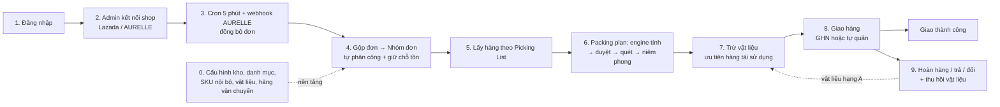
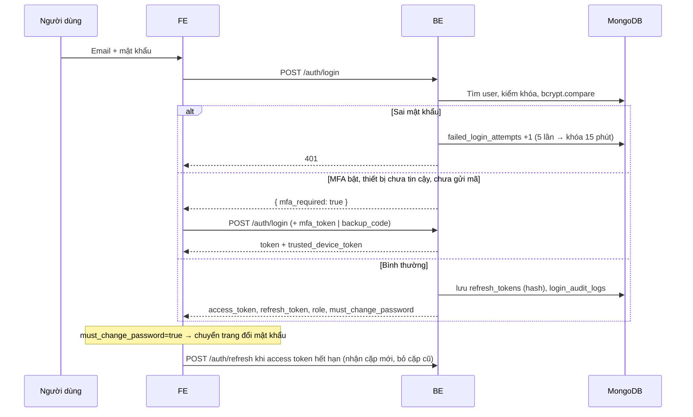
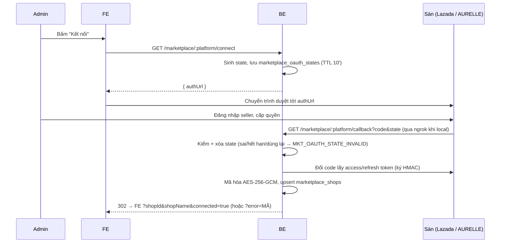
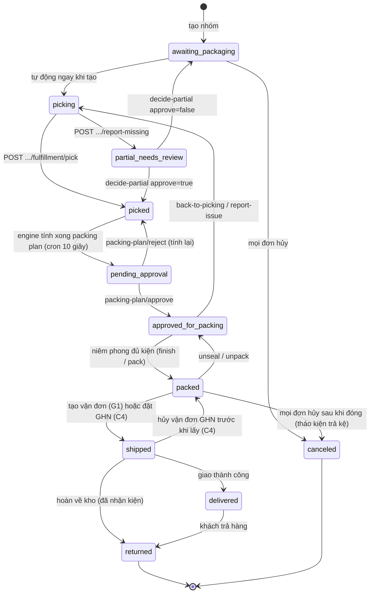
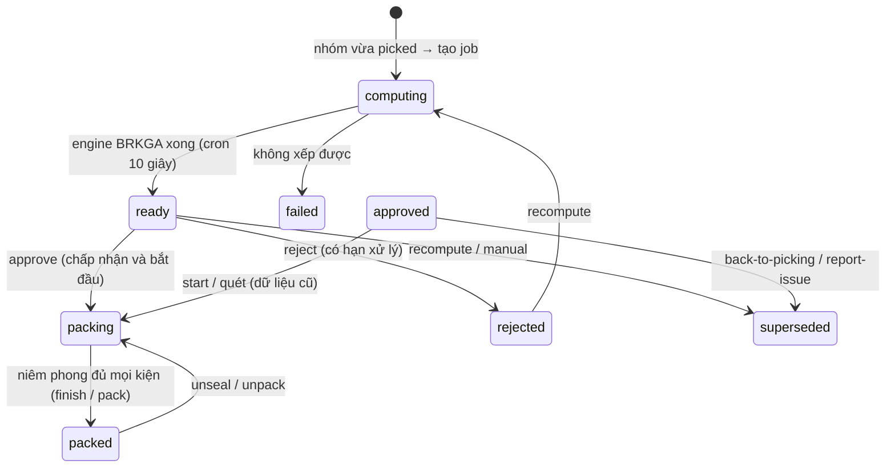
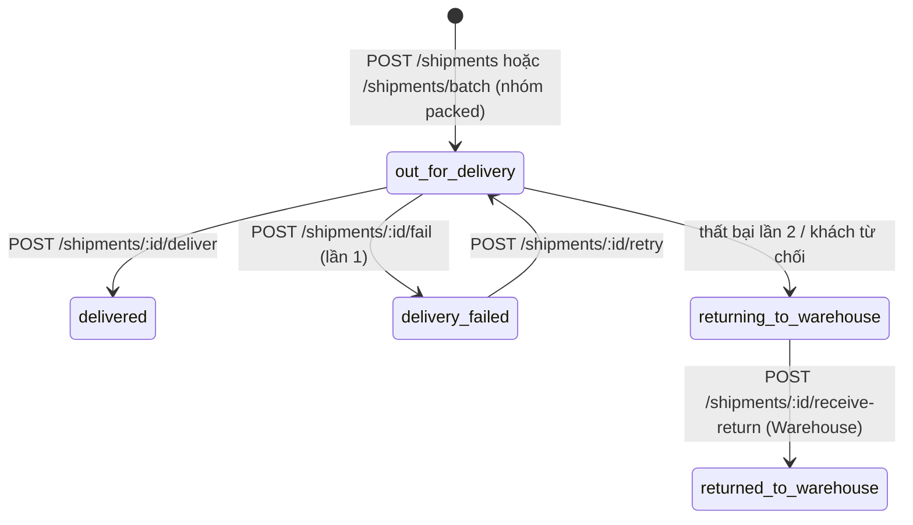
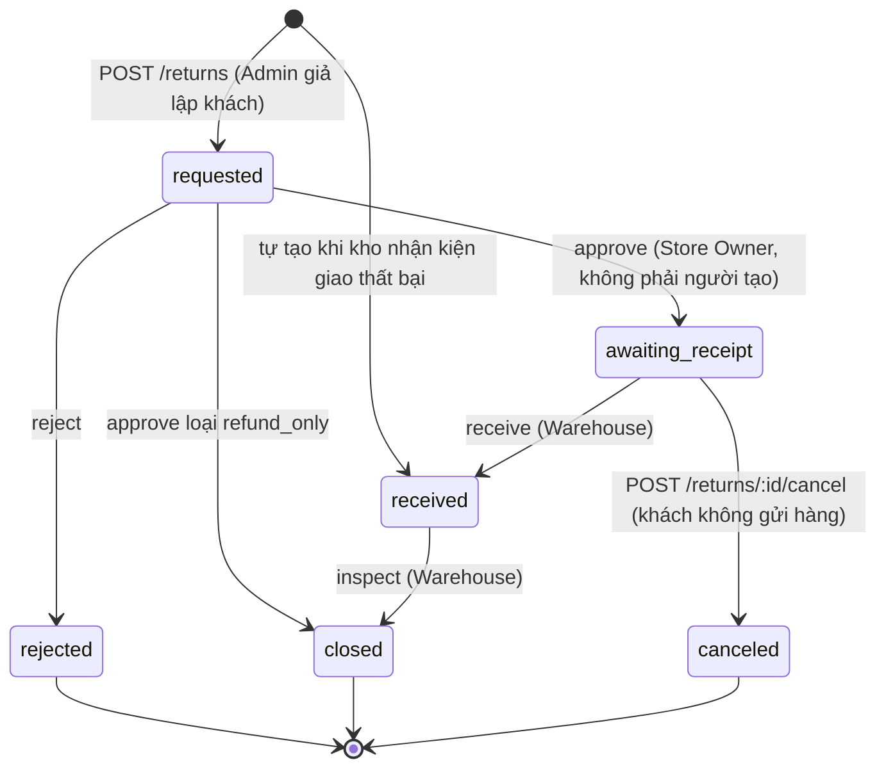

# 06 — Luồng nghiệp vụ và cách hệ thống chạy

> Cập nhật 14/10/2026 theo code hiện tại: đóng gói theo **packing plan** (engine BRKGA + CP-SAT), giao hàng qua **GHN** (C4–C6) hoặc tự quản (G1), sàn demo **AURELLE**. OptiPack **không báo pack/RTS lên Lazada** nữa (bỏ từ 10/10/2026).

Mỗi luồng gồm: ai thực hiện, các bước, API được gọi theo thứ tự, và dữ liệu bị thay đổi.

## Bức tranh toàn cảnh



---

## 0. Cấu hình nền (làm 1 lần trước khi vận hành)

| Bước | Ai | API | Dữ liệu |
|---|---|---|---|
| Tạo Admin đầu tiên | Kỹ thuật | `npm run seed:admin` | `users` |
| Tạo tài khoản nhân viên | Admin | `POST /users` | `users` (+ email mật khẩu tạm) |
| Danh mục + thang size | Admin | `POST /categories` | `categories` |
| Bảng màu | Admin | `POST /colors` | `colors` |
| Kho → khu → kệ/ô | Admin | `POST /warehouse/warehouses` → `POST .../zones` → `POST /warehouse/zones/:zoneId/racks` | `warehouses`, `warehouse_zones`, `bin_locations` |
| Đồng bộ danh sách sản phẩm Lazada | Admin (hoặc cron mỗi giờ / 3:00) | `POST /product-master/sync` (`?shop_id`, `?full=true`) | `product_master`, `marketplace_shops.last_product_synced_at` |
| SKU nội bộ + nối SKU sàn | Admin | `POST /master-skus` → `POST /master-skus/:code/mappings` (chỉ nối SKU đã có trong `product_master`) | `master_skus`, `marketplace_sku_mappings` |
| Gán SKU vào ô + tồn ban đầu | Admin | `POST .../sku-bin-assignments` | `sku_bin_assignments`, `inventory_movements` (`assign_initial`) |
| Gộp tồn theo SKU nội bộ | Admin | `POST /master-skus/sync-stock` | `sku_bin_assignments.master_sku`, `inventory_movements` (`sku_merge`) |
| Chuyển dữ liệu id cũ (1 lần mỗi DB, sau khi deploy bản 07/10/2026) | Kỹ thuật | `npx ts-node -r dotenv/config scripts/migrate-objectid-fields.ts --apply` | 35 trường id ở 18 collection |
| Danh mục vật liệu + nhập | Admin | `POST /packaging-materials` → `POST .../:code/purchase`; thùng/túi/vật tư: `POST /packaging/boxes|bags|materials` → `.../:id/stock-in` | `packaging_materials`, `packaging_boxes`, `packaging_bags`, `packaging_movements` |
| Hồ sơ đóng gói sản phẩm | Warehouse/Admin | `PUT /product-master/:id/packaging-profile` | `product_master` (kích thước, khối lượng, dễ vỡ…) — engine cần để xếp hộp |
| Hãng vận chuyển | Admin | `scripts/seed-shipping-carriers.ts`, `scripts/seed-ghn-carrier.ts`; `PUT /shipping/settings` | `shipping_carriers`, cài đặt chiến lược |
| Cài đặt đóng gói | Owner/Admin | `PUT /packing/settings` | Ngưỡng tự duyệt, phân công |

---

## 1. Đăng nhập



---

## 2. Kết nối shop (Lazada hoặc AURELLE)

Cùng một luồng cho mọi sàn — `:platform` là `lazada` hoặc `aurelle`.



- Lazada sandbox: tài khoản seller phải nằm trong whitelist của app; nếu dialog báo "Not Login" thì đăng nhập seller center trước rồi mới bấm cấp quyền.
- Kết nối shop mới **không xóa** shop cũ; shop cũ chuyển `inactive` (không xóa dữ liệu trong DB).

---

## 3. Đồng bộ đơn và gộp đơn

**Kích hoạt:** cron 5 phút/lần (`LazadaOrderSyncScheduler`, chạy cho mọi shop Lazada + AURELLE đang kết nối) hoặc Admin gọi tay `POST /orders/:platform/sync?shop_id=...` (`/orders/lazada/sync` vẫn giữ để tương thích).

1. Lấy access token còn hạn (tự refresh nếu sắp hết).
2. Gọi `GetOrders` theo mốc `last_polled_at`, phân trang theo thời gian; với mỗi đơn gọi `GetOrderItems`.
3. Mapper chuẩn hóa trạng thái (`OrderStatus`), người nhận, món hàng.
4. **Upsert** `orders` theo `(platform, shop_id, platform_order_id)`; `items` được ghi đè toàn bộ.
5. Tính `consolidation_key` = SHA-256(tên + SĐT + địa chỉ đã chuẩn hóa).
6. **Gộp đơn** (`tryConsolidate`): tìm đơn chưa hoàn tất cùng khóa → gán chung `consolidated_group_id`.
7. **`getOrCreateGroupForOrder`**: tạo nhóm đơn mới hoặc cập nhật nhóm cũ, tính lại số đếm đơn hủy. Với nhóm mới gọi **`startPickingPhase`**:
   - Tự phân công Warehouse Staff ít việc nhất.
   - **Giữ chỗ tồn** cho từng SKU (thiếu → `stock_shortage=true` + thông báo).
   - Chuyển trạng thái `awaiting_packaging` → `picking`.
8. Khách yêu cầu hủy (`need_cancel_confirm`) → thông báo Store Owner.
9. Cập nhật `marketplace_shops.last_polled_at`.

**Lưới an toàn:** cron `order-group-backfill` 5 phút/lần tạo nhóm cho đơn lỡ chưa có nhóm.

**AURELLE (sàn demo):** khách đặt hàng trên storefront (`POST /storefront/orders/checkout`) → storefront bắn webhook `POST /marketplace/webhooks/aurelle` (ký HMAC, chống trùng `message_id`) → BE đồng bộ **đúng 1 đơn** đó qua cùng mapper → vào nhóm đơn ngay, không chờ cron.

> ⚠️ Lỗ hổng đã biết (07): mỗi lượt sync Lazada chỉ lấy **100 đơn đầu** nhưng `last_polled_at` vẫn tiến → shop nhiều đơn có thể sót đơn. Tồn storefront AURELLE tách riêng tồn OptiPack, và OptiPack chưa ghi trạng thái ngược về AURELLE.

---

## 4. Vòng đời nhóm đơn



Bảng chuyển trạng thái nằm ở `order-groups/enums/allowed-status-transitions.ts` (có spec). Mọi chuyển trạng thái đều kiểm bảng này.

---

## 5. Lấy hàng

| Bước | Ai | API | Hệ thống làm gì |
|---|---|---|---|
| Xem việc được giao | Warehouse | `GET /order-groups?fulfillment_status=picking` | Danh sách kèm `activeOrderCount`, `canceledOrderCount`, ưu tiên, hạn |
| Xem danh sách lấy hàng | Warehouse | `GET /warehouse/:warehouseId/picking-list/:groupId` | Món cần lấy (bỏ đơn hủy), ô chứa, sắp theo `pick_sequence`. Tìm dòng tồn: SKU đã nối → dòng gộp `master_sku`, nếu không có thì dòng chưa gắn nhãn cùng shop; SKU chưa nối → dòng chưa gắn nhãn cùng shop. So `seller_sku` không phân biệt hoa thường. Không có dòng nào → `CHƯA GÁN VỊ TRÍ` |
| Quét từng món | Warehouse | `POST .../fulfillment/pick-item` | Trong 1 transaction: trừ `quantity_on_hand` của ô (chỉ khi đủ, cùng cách tìm dòng tồn như trên), ghi `inventory_movements` (`pick`), `pick_events` (`order_group_id` ObjectId), tiêu thụ giữ chỗ. Trùng `client_event_id` → bỏ qua |
| Thiếu hàng | Warehouse | `POST .../fulfillment/report-missing` | Nhóm → `partial_needs_review`, thông báo |
| Quyết định thiếu | Packaging/Admin | `POST .../fulfillment/decide-partial` | Đóng gói phần có sẵn, hoặc trả về lấy lại |
| Xác nhận lấy xong | Warehouse | `POST .../fulfillment/pick` | `picking` → `picked`, nhả phần giữ chỗ còn dư, **tạo job tính packing plan** |

> 🔄 **07/10/2026:** trước ngày này Picking List trả `CHƯA GÁN VỊ TRÍ` và quét hàng trả 409 dù dữ liệu kho đúng, vì `warehouse_id` được truy vấn dạng chuỗi trong khi schema bị Mongoose hiểu là Mixed. Đã sửa ở cả schema (35 trường id) lẫn truy vấn. Dữ liệu cũ: chạy `scripts/migrate-objectid-fields.ts`.

---

## 6. Kế hoạch đóng gói (packing plan)

Thay hoàn toàn luồng "gợi ý đóng gói" cũ (`/order-groups/:id/packaging*` và `fulfillment/pack` **đã gỡ**). Collection: `packing_plans` (mỗi nhóm 1 bản `is_active=true`).



| Bước | Ai | API | Hệ thống làm gì |
|---|---|---|---|
| Tính phương án | Tự động | cron `packing-plan-auto-compute` (10 giây) | Lấy món **đã quét thực tế** (`pick_events`), kích thước/khối lượng từ `product_master` + `packaging profile`; engine BRKGA chọn thùng/túi, xếp món vào từng kiện. Nếu bật `packer/` (CP-SAT) thì chạy thêm để gắn nhãn `optimal_in_model`/`optimal_global` |
| Xem | Packaging/Warehouse/Coordinator/Owner | `GET /order-groups/:groupId/packing-plan` | Kiện, thùng, vật tư, cân ước tính, nhãn chứng minh tối ưu |
| Chấp nhận & đóng gói | Packaging/Admin | `POST .../packing-plan/approve` | `ready → packing`; nhóm `pending_approval → approved_for_packing`, cùng transaction; ghi người/giờ duyệt và bắt đầu, version +1 |
| Từ chối / tính lại | Packaging | `POST .../reject`, `POST .../recompute` | Ghi lý do, hạn xử lý (cron 15 phút nhắc quá hạn) |
| Sửa tay | Packaging | `POST .../manual`, `.../parcels/:n/change-box`, `.../move-item` | Lưu bản sửa, kiểm tồn thùng (`assertBoxInStock`) |
| Phân công | Hệ thống, Admin khi cần đổi người | Tự giao khi `ready`; `POST .../assign` để gán lại | Giữ tự chọn người ít việc; không có bước chốt riêng. Danh sách cá nhân: `GET /order-groups?assigned_packer_id=<userId>` (lọc trước phân trang) |
| Hướng dẫn AI | Packaging/Warehouse | `POST .../parcels/:n/guide` | Sinh hướng dẫn xếp bằng AI (thiếu `AI_API_KEY` → bỏ qua) |
| Đóng gói | Packaging/Warehouse | Sau chấp nhận: `parcels/:n/scan` → `parcels/:n/seal`; `finish` nếu cần | Mở quét/cân ngay từ response approve; sai món bị chặn, niêm phong đủ kiện → nhóm `packed`. `start` chỉ để tương thích `approved` cũ |
| Đóng nhanh | Packaging/Warehouse | `POST .../pack` | Niêm phong mọi kiện một lần (demo) |
| Sự cố | Packaging/Warehouse | `report-issue`, `back-to-picking`, `unseal`, `unpack` | Trả về lấy lại món / tháo kiện |
| Báo cáo | Owner/Admin | `GET /packing/reports/summary`, `/feedback`, `GET /packing-plans/summary` | Tỷ lệ lấp đầy, chi phí, phản hồi |

## 7. Trừ vật liệu và tái sử dụng

- Trừ vật liệu xảy ra **khi niêm phong kiện**, trong cùng transaction với cập nhật kế hoạch: ghi `packaging_movements`.
- **Ưu tiên `qty_reused`** (vật liệu hạng A thu hồi từ hàng hoàn) trước, hết mới trừ `qty_new`. Báo cáo tiết kiệm: `GET /packaging-materials/savings`.
- Tháo kiện (`unpack`) cộng trả vật liệu.
- Kho vật liệu: thùng/túi/vật tư quản lý ở `/packaging/boxes|bags|materials` (nhập kho `stock-in`) và `/packaging-materials` (mua `purchase`, dùng nội bộ `internal-use`).

> OptiPack **không** gọi API pack/RTS của Lazada (bỏ 10/10/2026). Trạng thái trên Lazada do seller tự xử lý trên Seller Center.

---

## 8. Giao hàng

Có 2 cách, cùng màn Vận chuyển và collection `shipments`:

### 8.1. Báo giá và chọn phương án (C6)

| Bước | API | Ghi chú |
|---|---|---|
| Danh sách hãng | `GET /shipping/carriers` | Hãng mẫu `SAMPLE-*` (bảng cước nội bộ) + `GHN` (`kind: 'live'`). Thêm GHN: `npx ts-node -r dotenv/config scripts/seed-ghn-carrier.ts` |
| Báo giá | `GET /shipping/quote/:groupId` | Mỗi kiện 1 lần Preview GHN; dòng GHN có `isLive`, `unavailableReason`, `assumptions` (đơn Lazada che địa chỉ → dùng `CARRIER_DEFAULT_PROVINCE` / `CARRIER_DEMO_RECIPIENT_PHONE`) |
| So phương án đóng gói | `GET /shipping/packaging-options/:groupId?carrier_code&service_code` | Tổng chi phí thùng + vật tư + phí ship cho từng thùng vừa kiện; áp dụng bằng `change-box` của packing plan |
| Chiến lược mặc định | `GET/PUT /shipping/settings` | `cheapest` / `fastest` / `fixed` |

### 8.2. Giao tự quản (G1 — hãng mẫu hoặc không chọn hãng)



### 8.3. Giao qua GHN (C4–C5, chế độ demo)

```mermaid
sequenceDiagram
    participant C as Coordinator
    participant BE
    participant GHN
    C->>BE: POST /shipments { carrier_code: "GHN", service_code, to_location? }
    BE->>GHN: create order — 1 đơn GHN / kiện (client_order_code SHP-xxx-n)
    GHN-->>BE: order_code, sort_code, phí, ETA
    BE->>BE: vận đơn awaiting_pickup, nhóm shipped, event carrier_booked
    Note over C,BE: Lỗi hãng → carrierBookingError; sửa PATCH /shipments/:id/to-location rồi POST .../carrier/book
    alt Môi trường thật
      GHN->>BE: POST /carriers/ghn/webhook (X-OptiPack-Secret)
    else Demo (CARRIER_MANUAL_STATUS_ENABLED=true)
      C->>BE: POST /shipments/:id/carrier/simulate { status }
    else Dự phòng mất webhook
      C->>BE: POST /shipments/:id/carrier/sync
    end
    BE->>BE: processCarrierEvent: chống trùng → map trạng thái → gộp theo kiện (canCarrierMove)
```

| Trạng thái GHN | Vận đơn OptiPack | Nhóm đơn |
|---|---|---|
| ready_to_pick, picking, money_collect_picking | `awaiting_pickup` | `shipped` |
| picked, storing, transporting, sorting | `in_transit` | `shipped` |
| delivering, money_collect_delivering | `out_for_delivery` | `shipped` |
| delivery_fail | `delivery_failed` | `shipped` |
| delivered (**mọi kiện**) | `delivered` | `delivered` |
| waiting_to_return, return, return_transporting, return_sorting, returning, return_fail, returned | `returning_to_warehouse` | `shipped` — kho **vẫn phải bấm** `receive-return` |
| cancel (trước khi lấy) | `cancelled` | về `packed` |
| exception, lost, damage, scrap | giữ trạng thái + cờ `carrierIncident` (event `carrier_incident`) | — |

- Nút G1 (`deliver`/`fail`/`retry`) với vận đơn GHN → `409 SHP_MANAGED_BY_CARRIER`.
- Hủy ở hãng: `POST /shipments/:id/carrier/cancel` (chỉ khi chờ lấy) → đặt lại được, mã mới `SHP-xxx-R<lượt>-n`.
- Nhãn: `GET /documents/shipping-label/:groupId` (mã GHN + sort code từng kiện) hoặc `GET /shipments/:id/carrier/label` (link A5 của GHN). Bảng kê chuyến: `GET /documents/manifest/:tripCode`.
- **GHN không cho shop đổi trạng thái đơn.** Nút giả lập chỉ đổi DB OptiPack; trên GHN staging đơn vẫn `ready_to_pick` cho tới khi hủy.
- Mọi bước ghi `shipment_events` (`source`: `manual` / `webhook` / `simulate` / `sync`, kèm `carrier_status`). Cron 15 phút gắn `is_overdue` cho vận đơn quá `due_at`.

Luật gộp trạng thái nhiều kiện (`aggregateCarrierStatus`): mọi kiện hủy → `cancelled`; có kiện đang hoàn → cả vận đơn `returning_to_warehouse`; có kiện giao thất bại → `delivery_failed`; mọi kiện đã giao → `delivered`; còn lại lấy kiện **chậm nhất**. `canCarrierMove` cho phép nhảy cóc (webhook có thể đến lệch thứ tự) nhưng không rời trạng thái kết thúc, không quay về chờ lấy, và `returned_to_warehouse` chỉ do kho quét nhận.

---

## 9. Trả hàng và đổi hàng

**18/10/2026 — tiến độ nhóm đơn với `return_refund` do Admin tạo:**

| Mốc | Trạng thái nhóm / nhãn |
|---|---|
| Tạo phiếu trả đủ nhóm | `returning` — Đang hoàn |
| Store duyệt | `returned` — Đã hoàn hàng |
| Kho nhận kiện | Giữ `returned` |
| Kho kiểm và xử lý tồn xong | `canceled` — Đã hủy |
| Store từ chối/hủy phiếu trước nhận hàng | Khôi phục `delivered` |

Trả một phần giữ `delivered`; cộng các phiếu `return_refund` cùng nguồn đã `closed` với phiếu hiện tại theo từng SKU để xét trả đủ. Ghi nhóm/phiếu/tồn trong cùng transaction; snapshot ngày giao gốc giữ hạn 15 ngày. Phiếu cũ đang mở tiếp tục từ thao tác kế tiếp, phiếu đã kết thúc không backfill. Luồng đổi hàng/chỉ hoàn tiền/giao thất bại giữ nguyên. FE lấy `OrderGroup.fulfillmentStatus`, không dùng trạng thái phiếu/hãng làm tiến độ nhóm. Chi tiết và checklist: [hướng dẫn Shipping C.0](../INTEGRATION_GUIDE_SHIPPING.md).

Vòng đời **phiếu** vẫn giữ:



- **Kiểm hàng** từng dòng: `restock` → nhập lại ô (`return_restock`; ô chưa có dòng tồn của SKU thì tạo dòng mới mang đúng `master_sku` nếu SKU đã nối, hoặc đủ `platform`/`shop_id`/`seller_sku` nếu chưa nối); `quarantine` → danh sách cách ly, sau xử lý bằng `POST /returns/:id/quarantine/:lineIndex/resolve`; `discard` → loại bỏ.
- Kèm kiểm **vật liệu thu hồi** (hạng A vào kho tái sử dụng nếu đã gỡ nhãn cũ và chưa quá số lần dùng; B vào kho nội bộ; C loại bỏ).
- **Đổi hàng**: sau kiểm hàng, tự tạo đơn `EXC-<mã RMA>` + nhóm đơn mới (`origin=replacement`) và đi lại luồng lấy hàng → đóng gói → giao. Lỗi thì Admin bấm `create-replacement`.

**Thu hồi vật liệu (G4):** khi kiểm hàng hoàn, gửi thêm `packaging[]` cho từng thùng/vật tư: hạng **A** (đã gỡ nhãn cũ, chưa quá số lần dùng) → cộng `qty_reused` và được **dùng trước** ở lần đóng gói kế tiếp; **B** → kho dùng nội bộ; **C** → loại bỏ. Mọi thay đổi ghi `packaging_movements`.

**Kịch bản demo đầy đủ:** đặt GHN → giả lập `picked` → `delivering` → `delivery_fail` → `returning` → `returned` → kho `receive-return` → phiếu `failed_delivery` tự tạo → `inspect` (restock hàng + thu hồi thùng hạng A) → nhóm khác đóng gói sẽ trừ thùng tái sử dụng trước.

---

## 10. Vận hành kho hằng ngày

| Việc | Ai | API | Sổ cái |
|---|---|---|---|
| Xem ô và tồn theo ô | Warehouse | `GET .../bin-locations`, `GET .../sku-bin-assignments` | — |
| Nhập thêm hàng | Warehouse | `POST .../:assignmentId/restock` (🔄 07/10/2026: hết lỗi luôn 404) | `receive` |
| Kiểm kê | Warehouse | `POST .../:assignmentId/adjust` (số đếm thực tế + lý do) | `adjust` |
| Chuyển ô | Warehouse | `POST .../:assignmentId/transfer` | `transfer_out` + `transfer_in` |
| Gợi ý ô cất hàng | Warehouse | `GET .../bin-suggestions?category_code&size&color_code` | — |
| Lịch sử 1 dòng tồn | Warehouse/Owner | `GET .../:assignmentId/movements` | — |
| Xem tồn khả dụng | Owner/Warehouse | `GET /stock-availability?platform&shop_id&seller_sku` | — |

---

## 11. Gộp tồn theo SKU nội bộ

1. Admin tạo SKU nội bộ `ATHUN-005-DEN-M`, nối các SKU sàn (`POST /master-skus/:code/mappings`).
2. `POST /master-skus/sync-stock` gắn `master_sku` cho các dòng tồn đã có.
3. Từ đó `stock_key` của SKU sàn = SKU nội bộ: tồn và giữ chỗ được tính **chung** cho mọi sàn bán sản phẩm đó.
4. Nhập/thay mã sai: `POST /master-skus/:code/replace` (tạo mã mới, chuyển mapping và tồn).

---

## 12. Thông báo

| Loại | Khi nào | Mức |
|---|---|---|
| `missing_item` | Báo thiếu hàng khi lấy | critical |
| `stock_shortage` | Thiếu tồn ngay khi giữ chỗ | critical |
| `pending_approval` | Có gợi ý đóng gói chờ duyệt | info |
| `packaging_rejected` | Gợi ý bị từ chối | warning |
| `sla_warning` / `sla_breach` | Đơn hỏa tốc sắp / đã quá hạn đóng gói | warning / critical |
| `cancel_confirmation_required` | Khách yêu cầu hủy, chờ seller xác nhận | critical |
| `delivery_failed` | Giao thất bại, còn lượt giao lại | warning |
| `delivery_returning` / `delivery_overdue` | Tự hoàn về kho / quá hạn giao | critical |
| `return_requested` | Có phiếu trả/đổi mới | warning |
| `sync_failed` | Đồng bộ đơn lỗi (tối đa 1 lần / 20 phút / shop); `relatedEntityId` = id document shop đã kết nối | warning |
| `connection_lost` | Webhook AURELLE báo shop mất kết nối / thu hồi quyền | critical |
| `abnormal_package` | **Khai báo nhưng chưa gửi** — lệch cân chỉ gắn cờ | — |

`relatedEntityId` luôn là ObjectId hoặc `null` (giá trị không phải id được ghi `null`, có cảnh báo trong log). Mọi thông báo đều được gửi thêm email (tới người nhận cụ thể, hoặc mọi người đang hoạt động thuộc vai trò nhận). Lỗi gửi email chỉ ghi log, không chặn thao tác chính.

FE đọc qua `GET /notifications`, `GET /notifications/unread-count`, `PATCH /notifications/:id/read`.
