# OptiPackAI — ERD và danh sách collection

> Cập nhật 14/10/2026 — đối chiếu tự động từ `be/src/**/*.schema.ts` (50 collection). Chi tiết từng field + index: `GUIDE_DOC/BE_SPEC/05_THIET_KE_CSDL.md` mục 4. Bản ERD cũ (05/10, thiếu đóng gói/vận chuyển/storefront) xem lịch sử git.

## 1. ERD tổng quan

```mermaid
erDiagram
  USERS ||--o{ REFRESH_TOKENS : "phiên"
  USERS ||--o{ TRUSTED_DEVICES : "thiết bị tin cậy"
  USERS ||--o{ LOGIN_AUDIT_LOGS : "nhật ký đăng nhập"
  USERS ||--o{ NOTIFICATIONS : "nhận"
  USERS ||--o{ MARKETPLACE_SHOPS : "kết nối"
  USERS ||--o{ ORDER_GROUPS : "được giao (assigned_staff_id)"
  MARKETPLACE_SHOPS ||--o{ ORDERS : "kéo về"
  ORDERS }o--|| ORDER_GROUPS : "consolidated_group_id"
  ORDER_GROUPS }o--o{ ORDER_GROUPS : "recipient_key / manual_link_id"
  ORDER_GROUPS ||--o{ PICK_EVENTS : "lần quét lấy hàng"
  ORDER_GROUPS ||--o{ STOCK_RESERVATIONS : "giữ chỗ tồn"
  STOCK_RESERVATIONS }o--|| STOCK_RESERVATION_TOTALS : "stock_key"
  ORDER_GROUPS ||--o| PACKING_PLANS : "1 kế hoạch đang hoạt động"
  PACKING_PLANS ||--o{ PACKAGING_MOVEMENTS : "trừ thùng/vật tư"
  PACKAGING_MATERIALS ||--o{ PACKAGING_MOVEMENTS : "sổ vật liệu"
  ORDER_GROUPS ||--o| SHIPMENTS : "1 vận đơn chiều đi"
  SHIPPING_CARRIERS ||..o{ SHIPMENTS : "carrier_code"
  SHIPMENTS ||--o{ SHIPMENT_EVENTS : "lịch sử"
  SHIPMENTS ||--o{ CARRIER_WEBHOOK_EVENTS : "sự kiện GHN"
  ORDER_GROUPS ||--o{ RETURN_REQUESTS : "phiếu trả/hoàn"
  SHIPMENTS ||--o{ RETURN_REQUESTS : "hoàn do giao thất bại"
  WAREHOUSES ||--o{ WAREHOUSE_ZONES : "khu"
  WAREHOUSE_ZONES ||--o{ BIN_LOCATIONS : "ô"
  BIN_LOCATIONS ||--o{ SKU_BIN_ASSIGNMENTS : "tồn theo ô"
  SKU_BIN_ASSIGNMENTS ||--o{ INVENTORY_MOVEMENTS : "sổ cái kho"
  CATEGORIES ||--o{ MASTER_SKUS : "danh mục"
  COLORS ||--o{ MASTER_SKUS : "màu"
  MASTER_SKUS ||--o{ MARKETPLACE_SKU_MAPPINGS : "SKU sàn nối vào"
  MASTER_SKUS ||..o{ SKU_BIN_ASSIGNMENTS : "master_sku (tồn gộp)"
  MARKETPLACE_SHOPS ||--o{ PRODUCT_MASTER : "catalog sàn"
  STOREFRONT_CATEGORIES ||--o{ STOREFRONT_PRODUCTS : "danh mục web"
  STOREFRONT_PRODUCTS ||--o{ STOREFRONT_PRODUCT_VARIANTS : "biến thể"
  STOREFRONT_PRODUCT_VARIANTS ||--o| STOREFRONT_INVENTORY_STOCKS : "tồn web"
  CUSTOMERS ||--o{ CUSTOMER_ADDRESSES : "địa chỉ"
  CUSTOMERS ||--o| STOREFRONT_CARTS : "giỏ"
  STOREFRONT_CARTS ||--o{ STOREFRONT_CART_ITEMS : "món"
  CUSTOMERS ||--o{ STOREFRONT_ORDERS : "đặt"
  STOREFRONT_ORDERS ||--o{ STOREFRONT_ORDER_ITEMS : "món"
  STOREFRONT_ORDERS ||--o| STOREFRONT_PAYMENTS : "thanh toán"
  STOREFRONT_ORDERS ||--o| STOREFRONT_SHIPMENTS : "giao (phía web)"
  STOREFRONT_ORDERS ||..|| ORDERS : "webhook + Open API → đơn platform aurelle"
```

Quan hệ là **tham chiếu logic** (ObjectId hoặc mã); MongoDB không ép khoá ngoại — toàn vẹn do service + transaction bảo đảm. Đường nét đứt = nối bằng mã (không phải ObjectId).

## 2. Danh sách collection

50 collection khai báo trong `*.schema.ts`; 49 đang được module đăng ký (`MongooseModule.forFeature`).

| Nhóm | Collection | Schema — file | Field | Index | Dùng trong module |
|---|---|---|---|---|---|
| Tài khoản & bảo mật | `users` | `UserSchema` — `modules/users/schemas/user.schema.ts` | 24 | 3 | ✔ |
| Tài khoản & bảo mật | `refresh_tokens` | `RefreshTokenSchema` — `modules/auth/schemas/refresh-token.schema.ts` | 10 | 3 | ✔ |
| Tài khoản & bảo mật | `trusted_devices` | `TrustedDeviceSchema` — `modules/auth/schemas/trusted-device.schema.ts` | 5 | 3 | ✔ |
| Tài khoản & bảo mật | `login_audit_logs` | `LoginAuditLogSchema` — `modules/auth/schemas/login-audit-log.schema.ts` | 7 | 2 | ✔ |
| Tài khoản & bảo mật | `notifications` | `NotificationSchema` — `modules/notifications/schemas/notification.schema.ts` | 12 | 4 | ✔ |
| Kết nối sàn & đơn | `marketplace_shops` | `MarketplaceShopSchema` — `modules/marketplace-integration/schemas/marketplace-shop.schema.ts` | 15 | 2 | ✔ |
| Kết nối sàn & đơn | `marketplace_oauth_states` | `MarketplaceOauthStateSchema` — `modules/marketplace-integration/schemas/marketplace-oauth-state.schema.ts` | 4 | 2 | ✔ |
| Kết nối sàn & đơn | `processed_webhook_events` | `ProcessedWebhookEventSchema` — `common/schemas/processed-webhook-event.schema.ts` | 3 | 2 | ✔ |
| Kết nối sàn & đơn | `orders` | `OrderSchema` — `modules/orders/schemas/order.schema.ts` | 44 | 4 | ✔ |
| Kết nối sàn & đơn | `order_groups` | `OrderGroupSchema` — `modules/order-groups/schemas/order-group.schema.ts` | 31 | 6 | ✔ |
| Kết nối sàn & đơn | `pick_events` | `PickEventSchema` — `modules/order-groups/schemas/pick-event.schema.ts` | 12 | 3 | ✔ |
| Kết nối sàn & đơn | `stock_reservations` | `StockReservationSchema` — `modules/order-groups/schemas/stock-reservation.schema.ts` | 12 | 3 | ✔ |
| Kết nối sàn & đơn | `stock_reservation_totals` | `StockReservationTotalSchema` — `modules/order-groups/schemas/stock-reservation.schema.ts` | 2 | 0 | ✔ |
| Kho & sản phẩm | `warehouses` | `WarehouseSchema` — `modules/warehouse/schemas/warehouse.schema.ts` | 6 | 1 | ✔ |
| Kho & sản phẩm | `warehouse_zones` | `WarehouseZoneSchema` — `modules/warehouse/schemas/warehouse-zone.schema.ts` | 7 | 2 | ✔ |
| Kho & sản phẩm | `bin_locations` | `BinLocationSchema` — `modules/warehouse/schemas/bin-location.schema.ts` | 18 | 6 | ✔ |
| Kho & sản phẩm | `sku_bin_assignments` | `SkuBinAssignmentSchema` — `modules/warehouse/schemas/sku-bin-assignment.schema.ts` | 9 | 5 | ✔ |
| Kho & sản phẩm | `inventory_movements` | `InventoryMovementSchema` — `modules/warehouse/schemas/inventory-movement.schema.ts` | 17 | 4 | ✔ |
| Kho & sản phẩm | `categories` | `CategorySchema` — `modules/categories/schemas/category.schema.ts` | 8 | 2 | ✔ |
| Kho & sản phẩm | `colors` | `ColorSchema` — `modules/master-skus/schemas/color.schema.ts` | 6 | 1 | ✔ |
| Kho & sản phẩm | `master_skus` | `MasterSkuSchema` — `modules/master-skus/schemas/master-sku.schema.ts` | 17 | 2 | ✔ |
| Kho & sản phẩm | `marketplace_sku_mappings` | `MarketplaceSkuMappingSchema` — `modules/master-skus/schemas/marketplace-sku-mapping.schema.ts` | 7 | 2 | ✔ |
| Kho & sản phẩm | `product_master` | `ProductMasterSchema` — `modules/product-master/schemas/product-master.schema.ts` | 26 | 2 | ✔ |
| Đóng gói & vật liệu | `packing_plans` | `PackingPlanSchema` — `modules/packing/schemas/packing-plan.schema.ts` | 190 | 7 | ✔ |
| Đóng gói & vật liệu | `packing_settings` | `PackingSettingsSchema` — `modules/packing/schemas/packing-settings.schema.ts` | 10 | 1 | ✔ |
| Đóng gói & vật liệu | `packaging_materials` | `PackagingMaterialSchema` — `modules/packaging-materials/schemas/packaging-material.schema.ts` | 32 | 3 | ✔ |
| Đóng gói & vật liệu | `packaging_movements` | `PackagingMovementSchema` — `modules/packaging-materials/schemas/packaging-movement.schema.ts` | 14 | 3 | ✔ |
| Đóng gói & vật liệu | `packaging_bags` | `PackagingBagSchema` — `modules/packaging/schemas/packaging-bag.schema.ts` | 11 | 2 | ✔ |
| Đóng gói & vật liệu | `packaging_material_rules` | `PackagingMaterialRulesSchema` — `modules/packaging/schemas/packaging-material-rules.schema.ts` | 13 | 2 | ✔ |
| Đóng gói & vật liệu | `packaging_recommendations` | `PackagingRecommendationSchema` — `modules/packaging/schemas/packaging-recommendation.schema.ts` | 142 | 3 | ❌ không module nào đăng ký |
| Vận chuyển & trả hàng | `shipping_carriers` | `ShippingCarrierSchema` — `modules/shipping/schemas/shipping-carrier.schema.ts` | 18 | 1 | ✔ |
| Vận chuyển & trả hàng | `shipping_settings` | `ShippingSettingsSchema` — `modules/shipping/schemas/shipping-settings.schema.ts` | 6 | 1 | ✔ |
| Vận chuyển & trả hàng | `shipments` | `ShipmentSchema` — `modules/shipments/schemas/shipment.schema.ts` | 65 | 8 | ✔ |
| Vận chuyển & trả hàng | `shipment_events` | `ShipmentEventSchema` — `modules/shipments/schemas/shipment-event.schema.ts` | 13 | 2 | ✔ |
| Vận chuyển & trả hàng | `carrier_webhook_events` | `CarrierWebhookEventSchema` — `modules/shipments/schemas/carrier-webhook-event.schema.ts` | 11 | 2 | ✔ |
| Vận chuyển & trả hàng | `return_requests` | `ReturnRequestSchema` — `modules/shipments/schemas/return-request.schema.ts` | 47 | 3 | ✔ |
| Website AURELLE (storefront) | `storefront_categories` | `StorefrontCategorySchema` — `modules/storefront/schemas/storefront.schema.ts` | 9 | 1 | ✔ |
| Website AURELLE (storefront) | `storefront_products` | `StorefrontProductSchema` — `modules/storefront/schemas/storefront.schema.ts` | 22 | 2 | ✔ |
| Website AURELLE (storefront) | `storefront_product_variants` | `StorefrontProductVariantSchema` — `modules/storefront/schemas/storefront.schema.ts` | 18 | 2 | ✔ |
| Website AURELLE (storefront) | `storefront_images` | `StorefrontImageSchema` — `modules/storefront/schemas/storefront.schema.ts` | 3 | 0 | ✔ |
| Website AURELLE (storefront) | `storefront_inventory_stocks` | `StorefrontInventoryStockSchema` — `modules/storefront/schemas/storefront.schema.ts` | 7 | 1 | ✔ |
| Website AURELLE (storefront) | `customers` | `CustomerSchema` — `modules/storefront/schemas/storefront.schema.ts` | 11 | 1 | ✔ |
| Website AURELLE (storefront) | `customer_addresses` | `CustomerAddressSchema` — `modules/storefront/schemas/storefront.schema.ts` | 11 | 1 | ✔ |
| Website AURELLE (storefront) | `storefront_carts` | `StorefrontCartSchema` — `modules/storefront/schemas/storefront.schema.ts` | 5 | 1 | ✔ |
| Website AURELLE (storefront) | `storefront_cart_items` | `StorefrontCartItemSchema` — `modules/storefront/schemas/storefront.schema.ts` | 7 | 2 | ✔ |
| Website AURELLE (storefront) | `storefront_orders` | `StorefrontOrderSchema` — `modules/storefront/schemas/storefront.schema.ts` | 28 | 7 | ✔ |
| Website AURELLE (storefront) | `storefront_order_items` | `StorefrontOrderItemSchema` — `modules/storefront/schemas/storefront.schema.ts` | 12 | 1 | ✔ |
| Website AURELLE (storefront) | `storefront_payments` | `StorefrontPaymentSchema` — `modules/storefront/schemas/storefront.schema.ts` | 10 | 1 | ✔ |
| Website AURELLE (storefront) | `storefront_shipments` | `StorefrontShipmentSchema` — `modules/storefront/schemas/storefront.schema.ts` | 15 | 1 | ✔ |
| Website AURELLE (storefront) | `storefront_counters` | `StorefrontCounterSchema` — `modules/storefront/schemas/storefront.schema.ts` | 1 | 0 | ✔ |

## 3. Ghi chú

- Mỗi nhóm đơn có tối đa 1 kế hoạch đóng gói đang hoạt động (`packing_plans.is_active`) và 1 vận đơn chiều đi (`shipments` unique `order_group_id + direction`); vận đơn GHN đã huỷ được đặt lại trên cùng document.
- Đơn AURELLE: website ghi `storefront_orders` → webhook ký HMAC → OptiPack đọc qua Open API giả lập → tạo `orders` với `platform = aurelle`. Chiều ngược (trạng thái giao, tồn) chưa có.
- Đánh giá thiết kế và việc cần sửa (index `consolidated_group_id`, regex SKU…): `05_THIET_KE_CSDL.md` mục 7.
